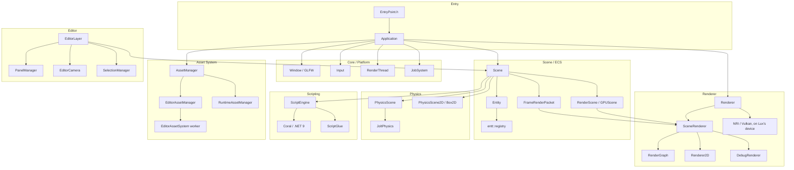

# LuxEngine Architecture Reference

Authoritative structural reference for agents and developers extending LuxEngine.

**This doc is structural, not API-level.** For function signatures, fields, and method lists, read
the header — it is the source of truth and never goes stale. Use this doc for system boundaries,
ownership, lifecycle, threading, extension hooks, and non-obvious invariants.

Companions: `.claude/docs/Conventions.md` (style + helper reuse), `.claude/docs/Building.md` (build
and regeneration), `.claude/docs/Threading.md` (thread contexts), `.claude/docs/Rendering.md`
(renderer invariants).

---

## Table of Contents

- [Part 1: System Overview](#part-1-system-overview)
- [Part 2: Per-System Notes](#part-2-per-system-notes)
- [Part 3: Cross-Cutting Concerns](#part-3-cross-cutting-concerns)
- [Part 4: Implementation Playbook](#part-4-implementation-playbook)
- [Part 5: Directory Map](#part-5-directory-map)

---

## Part 1: System Overview

LuxEngine is a C++20, Vulkan-only 3D game engine and editor. It is a solo project. It builds as a
static library (`Core`), a C# scripting assembly (`ScriptCore`), an editor application (`Editor`),
and a standalone runtime player (`Lux-Runtime`). Everything lives in the `Lux` C++ namespace.



### System summary

| System | Location | Key headers |
|---|---|---|
| Application / Core | `Core/Source/Lux/Core/` | `Application.h`, `Layer.h`, `RenderThread.h`, `JobSystem.h`, `Ref.h`, `Base.h` |
| Window / Platform | `Core/Source/Lux/Core/`, `Core/Platform/{Windows,Linux}/` | `Window.h`, `Thread.h` |
| Renderer | `Core/Source/Lux/Renderer/` | `Renderer.h`, `SceneRenderer.h`, `RenderGraph.h`, `FrameRenderPacket.h` |
| Vulkan backend | `Core/Source/Lux/Platform/Vulkan/` | `VulkanDevice.h`, `VulkanGPUProfiler.h`, `ShaderCompiler/`, `Debug/` (Aftermath) |
| Scene / ECS | `Core/Source/Lux/Scene/` | `Scene.h`, `Entity.h`, `Components.h`, `SceneSerializer.h` |
| Physics 3D | `Core/Source/Lux/Physics/` (+ `JoltPhysics/`) | `PhysicsSystem.h`, `PhysicsScene.h`, `PhysicsShapes.h` |
| Physics 2D | `Core/Source/Lux/Physics2D/` | via `Scene.h` |
| Scripting | `Core/Source/Lux/Scripting/` | `ScriptEngine.h`, `ScriptGlue.h`, `ScriptBuilder.h` |
| Assets | `Core/Source/Lux/Asset/` | `AssetManager.h`, `Asset.h`, `AssetTypes.h` |
| Audio | `Core/Source/Lux/Audio/` (+ `Native/`, miniaudio), `Core/vendor/soundwave/` | `AudioEngine.h`, `AudioEventInstance.h`, `AudioEventRef.h`, `Sound.h`, `AudioAcoustics.h`, `soundwave/Solve.h` |
| Editor framework | `Core/Source/Lux/Editor/` | `EditorPanel.h`, `PanelManager.h`, `EditorCamera.h`, `SelectionManager.h` |
| Editor app | `Editor/Source/` | `EditorLayer.h`, `Panels/` |
| ImGui | `Core/Source/Lux/ImGui/` | `ImGuiEx.h`, `ImGuiUtilities.h`, `Colors.h` |
| Project | `Core/Source/Lux/Project/` | `Project.h`, `ProjectSerializer.h`, `UserPreferences.h` |
| Serialization | `Core/Source/Lux/Serialization/` | `AssetPack.h`, `StreamReader/Writer.h` |
| Social | `Core/Source/Lux/Social/` | `DiscordSocial.h` |
| VR | `Core/Source/Lux/VR/` | `VRSession.h`, `LuxOpticTracker.h`, `LuxOpticConfig.h`, `StereoRig.h` |
| Build | repo root | `premake5.lua`, `Dependencies.lua`, `scripts/` |

### System dependency rules

Violations block the editor/runtime split and are rejected in review.

| System | May depend on | Must NOT depend on |
|---|---|---|
| Scene / ECS | Asset, Physics, Core, Renderer *types* | `Editor/Source/**` |
| Physics | Scene (read), Core, Math | Renderer, Editor, ScriptEngine |
| Renderer / SceneRenderer | Scene (read, via packet), Asset, Core | `Editor/Source/**`, Physics, ScriptEngine |
| ScriptEngine | Scene, Asset, Core (via ScriptGlue) | Renderer, `Editor/Source/**` |
| Asset system | Core, Project | Renderer internals, `Editor/Source/**` |
| VR | Scene (frame packet build/submit), Renderer, Core (`HID`, `Thread`, `Input`), Utilities, Serialization | `Editor/Source/**`, Physics, ScriptEngine; and nothing in Scene or Renderer includes VR |
| Editor panels | everything in `Core` | — (engine code never includes editor-app headers) |

Two notes specific to LuxEngine:

- `Scene.h` includes `Lux/Editor/EditorCamera.h` and `Renderer2D.h`. That is allowed: those are
  `Core`-owned editor *framework* types, not the editor application. The prohibition is on
  `Editor/Source/**`.
- `Core` must remain buildable and usable without `Editor`. `Lux-Runtime` is the proof — if a change
  breaks the runtime build, the dependency direction was violated.

---

## Part 2: Per-System Notes

### 2.1 Application lifecycle

`Application` (`Core/Source/Lux/Core/Application.h`) owns the window, layer stack, render thread,
event queue, application settings, and performance profiler. The client implements
`CreateApplication(argc, argv)` (see `EntryPoint.h`).

`ApplicationSpecification` carries name/size/vsync/fullscreen, `RendererConfig`,
`CoreThreadingPolicy`, `EnableSimulationThread`, `EnableImGui`, `EnableDiscordRichPresence`, and
`IconPath`.

**Construction order matters** and is not obvious: `s_MainThreadID` is captured, settings are
deserialized, `JobSystem::Init` runs, then `m_RenderThread.Run()`, and only *then* is the `Window`
created. The threading policy is therefore read from `App.lsettings` in `LuxEditorApp.cpp` *before*
the `Application` object exists, because `RenderThread` is constructed with it.

**Startup splash.** `ApplicationSpecification::DeferWindowShow` leaves the window hidden and unplaced
after construction; the client places it with `Application::PlaceWindow()` (maximized or centred, per
the specification) and shows it with `GetWindow().Show()`. A deferred window is not maximized while
hidden because X11 cannot restore it before it is shown. `StartupSplash`
(`Core/Source/Lux/Core/StartupSplash.h`, board 06 of the brand sheet) is the loading splash a layer
creates at the top of its `OnAttach` and `Finish()`es at the end of it. After `OnAttach` the layer calls `DrawUntilPresented()` from its
`OnImGuiRender` and destroys the splash when that returns false, three frames in: by then its first
frames have been presented into the still-hidden main window, so the window appears already drawn
rather than as an empty (debug-magenta) frame covering the splash. The static
`StartupSplash::Report(progress, status)` (a no-op when no splash is up, so any startup code may call
it) draws one frame through `Application::RenderStartupFrame`: one `Run()` iteration whose only UI is
the splash, with OS events polled but not dispatched to layers (`m_InStartupFrame`) and the event
queue left for `Run()`. With ImGui platform viewports (Windows) the splash is a borderless OS window of
its own; it places the hidden main window on creation and shows it when destroyed. Without them
(Linux) the splash can only draw in the main window, so on creation it sizes that window to the card
(960x540 at UI scale), centres and shows it; `Finish()` sets it back to `WindowWidth x WindowHeight`
(the size an unmaximize returns to), places it, and draws startup frames until the window manager has
maximized it (up to 30), because a frame laid out at the card's size would pull floating ImGui
windows into it and ImGui saves that. The editor sets `DeferWindowShow`. Because the
splash renders ImGui's first frame from inside `OnAttach`, `io.IniFilename` must be set before the first
`Report` (ImGui loads the ini on its first frame).

**Per-user data** lives in `FileSystem::GetPersistentStoragePath()` — `%APPDATA%\LuxEngine` on
Windows, `$XDG_DATA_HOME/LuxEngine` (default `~/.local/share/LuxEngine`) on Linux. The editor keeps
everything machine-local there: `App.lsettings` (`ApplicationSpecification::SettingsPath`, which
defaults to `./App.lsettings` for Lux-Runtime), `Workspaces.yaml` (personal layouts, active tab and
tab order), `UserPreferences.yaml`, and `logs/`. `imgui.ini`, `EditorLayout.yaml` and
`Layouts/<name>/` are imported non-destructively as personal layouts. The optional
`LUX_USER_DATA_DIR` overrides the entire per-user directory for isolated tests. The editor
defines `LUX_LOGS_IN_PERSISTENT_STORAGE` before including `EntryPoint.h`; Lux-Runtime logs to
`./logs`. Every run writes its own `LUX_<date>_<pid>.log` / `APP_<date>_<pid>.log`, so concurrent
instances don't clobber each other; `Log::Init` keeps the newest 10 sessions. Warnings and errors
are flushed to the files as they are logged, and spdlog's flusher thread flushes everything else once
a second, so a killed or hung process still leaves its last error on disk. Help → Open User Data
Folder opens the folder. `MigrateLegacyUserData` in `LuxEditorApp.cpp` copies files from the pre-2026-09-28
locations (`./App.lsettings`, `./imgui.ini`, the old `.../Editor` folder) when the new folder lacks
them. Nothing per-user belongs in the repo.

**Crash watchdog** (Windows, editor only). `Lux-Watchdog.exe` (`Watchdog/`, built into the editor's
output folder, no engine dependencies) watches the editor from outside. The editor opts in by defining
`LUX_CRASH_WATCHDOG L"Editor"` before including `EntryPoint.h`, which calls `CrashWatchdog::Start`
(`Core/Source/Lux/Debug/CrashWatchdog.h`) once logging exists and `MarkCleanExit` as the last thing in
`Lux::Main`. The two share a named mapping and two events (`CrashWatchdogProtocol.h`, named by the
editor's PID). An unhandled exception (also `abort`/`std::terminate`, pure-virtual calls and invalid
CRT parameters, raised as exceptions so they take the same path) signals the watchdog, which writes the
minidump from outside, then the handler flushes the logs (helper thread, 2 s limit) and the process
dies. `Application::Run` advances a heartbeat every iteration (it also re-installs the filter, which
.NET may replace); with hang detection on (the run loop only, not startup or `OnShutdown`) a heartbeat
still for `Watchdog::HangSeconds` (30) gets a quiet hang dump. A process that ends without
`MarkCleanExit` gets a report: `CrashReports/<App>-<time>/` under the per-user folder with the dump,
`report.txt` (exception code and module+offset, or the exit code; the engine log's last lines) and the
session's logs, and one dialog offering to open it. Newest 10 kept. Fail-fast (`0xC0000409`) and stack
overflow exits leave a report without a dump. Skipped under a debugger and when `LUX_NO_WATCHDOG` is
set (the golden runner sets it); `LUX_WATCHDOG_QUIET` suppresses the dialog. Aftermath still covers GPU
crashes.

**Layers** (`Layer.h`, `LayerStack.h`): `OnAttach` / `OnDetach` / `OnUpdate(Timestep)` /
`OnImGuiRender` / `OnEvent`. `PushLayer` for regular, `PushOverlay` for top. The editor and the
runtime each supply one. A layer is on the stack before its `OnAttach` runs, but no layer receives
events until it returns (`m_AttachingLayer`): `OnAttach` can pump the window before the layer's
members exist (startup frames, and on Wayland `glfwShowWindow`'s roundtrip delivers a resize
synchronously), so `OnEvent` may assume a fully attached layer.

**Frame loop** — see `.claude/docs/Threading.md § The frame loop` for the exact ordering. Do not add
per-frame work directly to `Application::Run`; add it to a layer's `OnUpdate`. (The one exception is
the crash watchdog's heartbeat, which must measure the loop itself.)

**Events** are two-stage: `QueueEvent` / `DispatchEvent<T>` are thread-safe and run by the next
`ProcessEvents()` on the main thread; `DispatchEvent<T>` additionally waits for `SyncEvents()`,
which `Application::Run` calls at the end of every frame. `DispatchEvent<T, true>` dispatches
immediately (main thread only).

### 2.2 Window / Platform

`Window` (`Core/Source/Lux/Core/Window.h`) is created via `Window::Create(WindowSpecification)` and
owns the GLFW window, the `VulkanDevice` (instance, device and queues, and the swapchain
settings in its `DeviceCreationParameters`), and the `RHISwapChain` (NRI's SwapChain extension,
which owns the surface; `Rendering.md § NRI device`). `Application::GetGraphicsDeviceManager()` is
the shortcut to the device manager; the GPU API itself is `RHIDevice`. `Window::Init` wraps the
Vulkan device in NRI (`RHIDevice::Init`, right after `CreateDevice`; Debug runs
`RHIDevice::RunSelfTest` there), and `Window::Shutdown` destroys the NRI device after the
swapchain, before the device manager.

Platform-specific implementations are separate translation units under
`Core/Platform/Windows/` and `Core/Platform/Linux/` (`*FileSystem.cpp`, `*Thread.cpp`,
`*RenderThread.cpp`, `*NativeWindow.cpp`), selected by a premake glob on `os.target()`. Add a platform behaviour by adding
the file to **both** folders — not with `#ifdef` in shared code.

### 2.3 Renderer

`RenderCommandQueue::IsExecuting()` identifies active command execution on the calling thread,
including Single mode and shutdown drains. `Renderer::Submit` executes nested work inline before
considering the main-thread producer path; shader reloads rebuild dependent pipelines and passes
before the next recorded draw under either policy. Resource frees use the same execution context.

Three layers (`Renderer` facade → `SceneRenderer` → `Renderer2D`/`DebugRenderer`) over NRI/Vulkan.

**Renderer vocabulary is `Renderer/RHI/RHITypes.h`**: `ShaderStage`, `TextureDimension`,
`TextureSubresourceRange` (a default range is *every* mip and layer), `GPUQueue`, `ResourceState`,
`DrawIndexedIndirectCommand`, and the render-target/viewport/vertex-attribute limits. Public
renderer headers, editor, scene and serialization code use these, never NRI types. The values are
NVRHI's, kept, because shader reflection, the shader cache (stage strings) and `ShaderPack.lsp`
store them (`RHITypes.cpp` checks them). Textures and buffers are described by `RHITextureDesc` /
`RHIBufferDesc` (`RHI/RHIResources.h`). `Image2D`/`Texture::GetHandle()` is
the NRI texture (renderer-internal); buffers have no handle getter (`GetBuffer()`). `RecordResourceUpload` callbacks take an `UploadContext` (P13). SPIR-V lives on `RHIShader` (`GetSPIRV(ShaderStage)`),
not the abstract `Shader`.

**NRI device** (`Renderer/RHI/RHIDevice.h`, NRI migration Phase 6): a static facade over an NRI
device created with `nriCreateDeviceFromVKDevice` on the VkDevice, queues and extension lists
`VulkanDevice` created. It never owns them. The primary graphics family must also support
compute (and presentation for a window). A requested dedicated compute family is optional;
when absent it is not created or exposed as an NRI queue, and command buffers use the existing
graphics-queue path. Queue-family discovery starts fresh for each candidate device, so indices
from another adapter cannot leak into selection. `RHIDevice::API()` is every NRI interface Lux uses (`NRIInterface`), `GetQueue(GPUQueue)`
the NRI queues (null when that family was not created), `GetDesc()` NRI's `DeviceDesc`. Every
submission goes through `RHIQueueTimeline` (`Renderer/RHI/RHIQueueTimeline.h`, created by
`Window::CreateRHIDevice` after `RHIDevice::Init`): one NRI timeline fence per queue, submissions
under `RenderCommandBuffer::LockQueue`, cross-queue waits, CPU waits. Every
draw and dispatch records through NRI (below). Device features: see `Rendering.md § NRI device`.

**GPU memory is NRI's** (Phase 8): `Image2D`, `VertexBuffer`, `IndexBuffer`, `UniformBuffer`,
`StorageBuffer`, meshlet buffers and the ImGui renderer own an `NRITexture`/`NRIBuffer`
(`Renderer/RHI/RHIResources.h`), which frees the NRI resource and its views through the GPU
deletion queue. `ImageInfo::RHITexture` is the NRI texture; swapchain
images also get non-owning NRI wrappers and color-attachment views. `Renderer::GetGPUMemoryStats`
reads NRI's `QueryVideoMemoryInfo`.

**NRI descriptors** (Phase 9; details in `Rendering.md § NRI device`):
- `RHIShader` builds an NRI pipeline layout from its reflection, and `PipelineCompute` an NRI
  compute pipeline.
- `DescriptorSetManager` (and so `RenderPass`, `ComputePass` and `Material`), `BindlessTextureTable`
  and `MeshSource` build NRI descriptor sets (`DescriptorSetGroup`), each with the resources it
  accesses (`DescriptorSetUses`).

**Recording on NRI** (Phases 10-13; details in `Rendering.md § NRI device`). Everything is recorded
into NRI command buffers (`CommandBufferPool`) and submitted through `RHIQueueTimeline`.
`RHISwapChain` hands out its acquire semaphore
(`TakeAcquireSemaphore`, once per frame) and signals its present semaphore in a signal-only NRI
submission.
- `Pipeline` builds its NRI pipeline from its specification, the shader's SPIR-V and the
  framebuffer's attachment formats (`Framebuffer::GetNRIColorFormat`/`GetNRIDepthFormat`), and
  `Framebuffer` builds NRI attachment views.
- `Renderer::BeginRenderPass` opens an NRI render pass on the `RenderCommandBuffer`
  (`RT_BeginNRIRenderPass`). The draw entry points (`RenderQuad`, `RenderGeometry`,
  `SubmitFullscreenQuad*`, `SceneRenderer::RT_DrawStaticMesh*`) record through
  `Renderer::RT_DrawIndexed` / `RT_DrawMeshTasks` (`RenderCommandBuffer::RT_BeginNRIDraw`), and
  `DispatchCompute` through `RenderCommandBuffer::RT_BeginNRIDispatch`. Work NRI cannot record is
  skipped and logged once per pipeline or shader. `Renderer::SwitchRenderPassPipeline`
  (`RenderCommandBuffer::RT_SwitchNRIRenderPassPipeline`) swaps the open pass's pipeline, layout and
  sets for a variant without splitting the pass.
- Copies and clears are NRI commands inside `RenderCommandBuffer::RT_BeginNRITransfer` (it closes an
  open NRI rendering scope). Storage-image clears go through a `StorageImageClear`
  (`Renderer/StorageImageClear.h`), which owns the descriptor set NRI clears through; its owner
  rebuilds it with the image's views. `Renderer::Init`/`Shutdown` create and free the layout clears
  bind.
- Uploads: `Renderer::RecordResourceUpload` hands its callback an `UploadContext`
  (`Renderer/RHI/UploadContext.h`) over the shared upload batch, which has its own tracker and
  stages through a `StagingStream` (`Renderer/RHI/StagingMemory.h`); command buffers write buffers
  with `RenderCommandBuffer::RT_WriteBuffer`. New textures and swapchain images get their first
  transition (undefined → resting state) in the batch.
- Queries and markers are NRI too: timestamp and pipeline-statistics query pools per command list
  slot, read back a frame-in-flight later, and `CmdBeginAnnotation` markers.
- Mesh vertex buffers hold `PackedVertex` (28 bytes: position, a QTangent frame quaternion, UV), packed
  from the CPU `Vertex` when `MeshSource` uploads; mesh files, caches and runtime packs keep `Vertex`.
  See `Rendering.md § Shaders`.
- `ImGuiRenderer::RenderToSwapchain` draws the UI into each swapchain with its own per-format
  pipelines, per-frame-slot geometry and descriptor pools. ImGui textures, the atlas included, are
  `Image2D`s in the shared `ImGuiTextureRegistry`. A frame with glass backdrops (§ 2.9) draws into
  the renderer's UI target instead and presents it at the end (`ImGuiGlass.hlsl`, mode PRESENT);
  each `ImGuiGlassBackdropCallback` command splits the ImGui pass for a dual-Kawase blur of the
  window's region into three smaller levels and a rounded-rectangle composite, then reopens it.
  Only over a cleared target (never the runtime's overlay); the targets are created on the main
  thread (`PrepareGlassBackdrops`) and reach the render thread inside the snapshot.

**Resource states** (`Rendering.md § Resource states`): each `RenderCommandBuffer` owns a
`ResourceStateTracker` + `NRIBarrierEmitter` (`Renderer/RHI/`), which record every barrier as an
NRI barrier into the open NRI command buffer. Resources are named by tracked descriptions made
when they are created (`NRITexture`/`NRIBuffer::GetTracked`, `ImageInfo::Tracked`). The tracker
places every barrier: NRI passes, draws and dispatches require what they bind
(attachments, descriptor-set uses, vertex/index/indirect buffers), copy/clear/write sites call
`RT_Require*`, and intra-pass transitions `RT_Transition*`. Texture readbacks
(`Renderer/TextureReadback.h`) copy into an NRI HOST_READBACK buffer and wait on an NRI fence
(`RenderCommandBuffer::RT_WaitForCompletion`).
The render graph declares how each pass touches each resource (`AccessKind`) and models storage
buffers (`AddExternalBuffer`); `SceneRenderer` passes `m_CommandBuffer` to `Execute`, which requires
each pass's entry states in one batch.

**Read `.claude/docs/Rendering.md` before changing anything here.** The invariants that are easy to
break and hard to see: the global `(set, binding)` namespace, pipeline caching, frame-numbered
resource release (`Renderer::RT_BeginFrame`), and `RenderGraph::ComputeStructureHash` completeness.

Structurally:

- `SceneRenderer` owns a `RenderGraph` and rebuilds its description each frame, caching the compile
  behind a structure hash. The pipeline is deferred PBR: G-buffer, clustered (froxel) light culling,
  HZB + GPU mesh culling (with GPU LOD through persistent main-view and shadow cull groups), GTAO, SSR, volumetric clouds, sky atmosphere, transparent forward, then
  post (TAA, auto-exposure, bloom, composite, SMAA, DOF).
- `RenderScene` / `GPUScene` / `MaterialScene` / `TextureScene` hold the persistent render-side
  mirror of the ECS, with `StaticMeshRenderProxy` entries and dirty flags. `Scene::SyncRenderScene`
  maintains them through `RenderScene::SyncStaticMesh(entityID, StaticMeshSyncInputs)`, which
  updates the retained proxy in place and does nothing more for an unchanged one. Material rows and
  texture slots are reference counted by the proxies' instances and rebuilt from
  `MaterialAsset::GetRevision()` (`Rendering.md § The GPU material table`). `MaterialTable` is
  changed only through its setters, which bump `MaterialTable::GetRevision()`. A scene keeps two mirrors: one for editor-camera views and one for the
  primary-camera path (`BuildRenderPacketRuntime`), because a mirror feeds exactly one
  `SceneRenderer` (`Rendering.md § Feeding the renderer from the scene`).
- `MaterialAsset` owns its scalar properties (albedo, metalness, roughness, emission, transparency,
  use-normal-map) in its own `Values` struct and mirrors them into the shader's push-constant block
  only where that block declares the member. The block is not a store: the opaque PBR shader has no
  `Transparency`, the transparent one has no material members at all. `MaterialScene` builds
  `GPUMaterialData` from the asset's values (the shader block is read only for a bare override
  `Material`, with fallbacks). Never read a material uniform with `Material::Get*` without
  `FindUniformDeclaration` first: in Release a missing member is an out-of-bounds read, not an assert.
- Advanced lobes (clearcoat, sheen, subsurface, anisotropy) are `MaterialSurfaceParameters` values,
  each off at its default; `MaterialScene` sets a GPU flag only for a lobe that is on, and the
  shaders evaluate it per pixel (`Rendering.md § The GPU material table`).
- **Material graphs** (`Renderer/MaterialGraph/`). A `MaterialAsset` may own a `MaterialGraph`
  (nodes, links, comments; stored in the `.lmat` under `Graph:`), whose `Compile()` emits the body
  of a GLSL surface function and the parameter layout. All of a project's graphs are compiled
  into the two surface shaders (`GBuffer_Static`, `HazelPBR_Transparent`), not into per-graph
  pipelines, so graph materials stay in the single GPU-driven pipeline. `MaterialGraphRegistry`
  (editor only, main thread, `Update` every frame from `EditorLayer::OnUpdate`) collects the
  graph-owning materials (`Register` is called by the serializer and may run on the asset worker),
  test-compiles each function on its own (`VulkanShaderCompiler::TryCompileGLSL`; a graph that fails
  gets index 0 and renders as the standard material), writes
  `Resources/Cache/Shader/Generated/MaterialGraphs.glslh` (a third include search path) and reloads
  the two shaders when it changed. The row carries the graph's 1-based index
  (`TransmissionTextureIndices.y`) and its parameters (`GraphParameters`), so parameter edits never
  recompile. Instances share the parent's graph object and override parameters by
  `Param.<name>` keys. A Material Function node (`SubGraph`) inlines another graph material's graph
  at compile time (variables prefixed `g<node>_`, Function Input nodes bound to the node's inputs,
  depth and cycle checked); its pins come from `MaterialGraph::GetPins`, the one source of per-node
  pins. Asset packs store each graph's parameter layout (`GraphLayout`, `HasPackedParameters`), so
  the run time never compiles and needs no function graphs. Export runs `ScanProject` in its Prepare step, writes `GraphIndex` and each
  instance's graph into the asset pack, and packs the recompiled shaders; at run time nothing is
  generated. The canvas is `Editor/.../MaterialEditor/MaterialGraphCanvas` on the vendored
  imgui-node-editor (`Core/vendor/imgui-node-editor`, MIT).
- Mesh vertex colours and the second UV set are `MeshSource::m_VertexAttributes` (empty, or one
  `VertexAttributes` per vertex), filled by `AssimpMeshImporter` when any mesh in the file has colour
  set 0 or UV set 1, written to asset packs under `MeshSourceFile::HasVertexAttributes` (between the
  vertex and index sections; older readers ignore it), and uploaded as the attribute stream
  (`Rendering.md`).
- **Material instances.** A `MaterialAsset` with a parent (`GetParent`, `.lmat` `Parent:` plus an
  `Overrides:` list of value keys) takes every value it does not override from the parent chain;
  transparency (the shader) is never inherited. The instance still holds and saves all its values,
  so the renderer, `MaterialScene` and asset packs see a plain material, a missing parent leaves the
  last values, and a pack load drops the parent. `MaterialAsset.cpp`'s `s_InstanceFields` table is the
  one list of inheritable values (key, compare, copy); a new material value needs an entry there.
  `InheritFrom` runs on editor load (the serializer loads the parent first, depth-capped) and from
  `OnDependencyUpdated(parent)` (the parent is a registered dependency);
  `PropagateToInstances(parent)` re-inherits loaded instances after a live edit (the Material Editor
  calls it each frame the material changed). Overrides are the values that differ from the parent at
  the end of an edit (`UpdateOverrides`); `SetParent` refuses a loop.
- "Lux Standard" inputs live in `MaterialSurfaceParameters` on the asset (emissive colour + map,
  occlusion map + strength, packed-map channel selection, specular, normal strength, height map as
  bump, UV tiling/offset/rotation, alpha mode + cutoff, two-sided, and for transparent materials
  refraction: transmission, IOR, thickness, attenuation colour + distance, imported from glTF
  `KHR_materials_transmission` / `_ior` / `_volume`). They reach shaders through the GPU material table
  (`Rendering.md § The GPU material table`); `MaterialSerializer` writes them as YAML keys (the
  asset pack stores the same YAML) and migrates pre-emissive-colour files as data.
- **Material textures are bindless through NRI descriptor sets.** Each `SceneRenderer` owns a
  `BindlessTextureTable` (one table per frame in flight, up to 16384 slots) that every material pass
  reads at the reserved descriptor set 4; a texture change is one slot write, not one `SetInput` per
  pass. Ownership, threading and the reserved-set rule are in `Rendering.md § Bindless textures`.
  Slots are keyed by texture and colour space (`GPUTextureSlot`): `MaterialScene` resolves albedo and
  emissive maps as sRGB, and `SceneRenderer` binds those to `MaterialAsset::GetSRGBTexture`.
- **Cutout materials are alpha-tested in pre-depth as well as the G-buffer.** `MaterialAlphaMode::Cutout`
  becomes `GPUMaterialAlphaMode::Masked` in the material row, with the authored threshold in
  `Surface.z`. Only Cutout draws (`MeshKey::AlphaMasked`) read the material table in pre-depth: they
  switch to `PreDepth_Masked.glsl` (`m_PreDepthMaskedPass`, never begun) inside the prepass, whose
  own `PreDepth.glsl` is depth-only. `m_PreDepthMaskedPass` binds
  `GPUMaterials`, `r_MaterialSampler` and `RendererData` plus its `BindlessTextureTable` (the
  bindless `u_GPUMaterialTextures`, set 4) — bound explicitly, not via `BindSceneRenderPassInputs(PassInputMaterialScene)`, because that would
  also rebind `ObjectIndexes` to the *visible* set and pre-depth uses the unculled one. The two
  passes must discard identically (same UV — the G-buffer's `(u, 1 − v)` — same mip bias, same cutoff) or the G-buffer fails its
  depth-equal test, so `GetMaterialMipBias` is duplicated verbatim in both shaders. `PreDepth_Meshlet`
  alpha-tests the same way: its mesh stage outputs the UVs, object index and view position, and
  `m_PreDepthMeshletPass` binds the same material inputs.
  Shadows alpha-test too: a Cutout caster (`MeshKey::AlphaMasked`) draws through
  `DirShadowMap_Masked` / `SpotShadowMap_Masked`, which bind the same material inputs, switched in
  inside the shadow passes.
  `MaterialAlphaMode::Blend` on a non-transparent asset resolves to Opaque — such a material is not
  in the sorted forward pass, so reporting Blend would describe a mode the frame never runs.
  `AssimpMeshImporter` maps glTF `alphaMode` onto this: MASK becomes Cutout with the file's
  `alphaCutoff`, and BLEND becomes a transparent asset.
- **Two-sided materials draw without back-face culling in pre-depth and the G-buffer.**
  `MaterialSurfaceParameters::TwoSided` (glTF `doubleSided` on import) and
  `MaterialFlag::TwoSided` resolve through `MaterialScene::ResolveRasterState` into
  `MeshKey::TwoSided`. Those draws use the two passes' no-cull variant pipelines, switched inside
  each pass (the raster-variant rule in `Rendering.md`). `GBuffer_Static` lights back faces with the normal
  flipped.
- **Diffuse transmission (light through leaves).** `MaterialSurfaceParameters::DiffuseTransmission`,
  `DiffuseTransmissionColor` and `DiffuseTransmissionMap` (glTF `KHR_materials_diffuse_transmission`,
  opaque and Cutout only) fill the GPU row's `Transmission` rows. `GBuffer_Static` writes the
  per-pixel factor to `normal.w`; `DeferredLighting` reads the colour through `MaterialID`. The
  Assimp importer does not read the extension (the vendored Assimp lacks it).
- `FrameRenderPacket` is the per-frame snapshot that decouples submission from the live registry.
- `RendererConfig::FramesInFlight` defaults to 3.
- Selection outline jump-flood inputs are rebound inside the render queue for each iteration,
  because the ping-pong pass is reused. Mask/distance data uses point sampling. Selection wireframes
  use the on-top pass; collider wireframes use a cached depth-tested variant unless On Top is enabled.
  Both share the scene color target, and the graph declares the collider depth read. Collider colors
  are captured per frame and written to material storage in render-queue order.
- Tone mapping uses a color-only framebuffer sharing the composite color image. It samples
  PreDepth without binding it as an attachment; the depth-bearing composite framebuffer remains
  the target for world/editor overlays. Both framebuffer views participate in resize and stale
  attachment repair, and the graph declares only color as the tone-mapping output.
- Compute-to-draw barriers accept `StorageBufferSet` and resolve its render-frame buffer at
  recording time. Mesh culling, cluster lighting and exposure use this path; indirect draw
  arguments transition to `ResourceState::IndirectArgument` before consumption. Mesh-culling output
  buffers use GPU-only storage with staged CPU initialization so the tracker tracks their
  transitions.

### 2.4 Scene / ECS

`Scene` (`Core/Source/Lux/Scene/Scene.h`) derives `Asset` and owns the `entt::registry`, the
`Renderer2D`, the physics scenes (`PhysicsScene` 3D, `PhysicsScene2D`), the `ScriptStorage` and live
`CSharpObject` instances, runtime audio sources, and the UUID→entity map.

`Entity` (`Entity.h`) is a thin wrapper over `entt::entity` + `Scene*` with
`AddComponent<T>` / `GetComponent<T>` / `TryGetComponent<T>` / `HasComponent<T...>` /
`RemoveComponent<T>`. Templates live in `EntityTemplates.h`, included at the bottom of `Scene.h`.

**Components** (`Components.h`): `IDComponent`, `TagComponent`, `TransformComponent`,
`RelationshipComponent`; rendering (`MeshComponent`, `StaticMeshComponent`, `SubmeshComponent`,
`MeshTagComponent`, `SpriteRendererComponent`, `CircleRendererComponent`, `TextComponent`,
`CameraComponent`); lighting (`DirectionalLightComponent`, `PointLightComponent`,
`SpotLightComponent`, `AreaLightComponent`, `SkyLightComponent`, `SkyAtmosphereComponent`,
`VolumetricCloudComponent`, `ExponentialHeightFogComponent`); physics 3D (`RigidBodyComponent`, `CharacterControllerComponent`,
`Box`/`Sphere`/`Capsule`/`Mesh`/`CompoundColliderComponent`); physics 2D (`RigidBody2DComponent`,
`BoxCollider2DComponent`, `CircleCollider2DComponent`); scripting (`ScriptComponent`,
`NativeScriptComponent`); audio (`AudioSourceComponent`, `AudioListenerComponent`);
`FolderComponent` (a purely organizational hierarchy grouping node — non-empty marker, kept out of
the transform/render paths); and `PrefabComponent`.

**Prefab instances:** an instantiated (or freshly created) prefab hierarchy carries a
`PrefabComponent{PrefabID, EntityID}` on every entity, linking each to its source entity inside the
prefab asset's scene. `SceneSerializer::GetOverriddenComponentKeys(instance, source)` diffs the two
entities' serialized component blocks to surface per-component overrides in the inspector, and
`Scene::ReconcilePrefabComponents(dst, src)` makes one entity's prefab-tracked components match the
other exactly (replace/add/remove) — together backing the editor's per-component and all-at-once
**Revert** (source → instance) / **Apply** (instance → source, then re-serialize the asset). True
**Variant prefabs** are self-contained prefabs that carry a `BasePrefab` handle (`Prefab::GetBasePrefab`),
serialized as an optional top-level `BasePrefab` key by `PrefabSerializer::WritePrefabFile` (the single
prefab-write path, so the base link survives every save). A variant instantiates like any prefab; on
saving a base, `EditorLayer::PropagateToVariants` refreshes each derived variant asset via
`Scene::AdoptPrefabBaseEdits` (UUID-matched, un-overridden entities adopt the base edit). **Prefab edit mode**
(EditorLayer) swaps the editing context to a copy of the prefab's scene (`ApplyEditorScene`, shared
with `OpenScene`); on save it writes the asset and calls `Scene::PropagatePrefabEdits`, which
refreshes un-overridden instances in the returned scene to the edited prefab's values.

**Prefab structure** (Unity-style overrides): `Scene::SyncPrefabInstance(root, prefabScene)` makes an
instance follow the prefab's hierarchy: entities the prefab gained are cloned in one at a time
(`ClonePrefabEntity`, parents first), entities it lost are destroyed after their surviving children move
up, children follow the prefab's parenting, and siblings follow its order (children the user added keep
their slots; there is no sibling-reorder UI, so order is never an override). User edits win: the editor records a deleted or moved
prefab child on the instance root (`Scene::RecordPrefabRemoval` / `RecordPrefabReparent`, called by
`SceneHierarchyPanel` before the edit) in `PrefabComponent::RemovedEntities` / `ReparentedEntities`
(serialized as `Removed` / `Reparented`; records about entities the prefab dropped are pruned), and
instance-added children are never touched. It runs in `PropagatePrefabEdits` before the component pass,
on `EditorLayer::OpenScene` and in `SceneAssetSerializer::SerializeToAssetPack` (`SyncAllPrefabInstances`,
through the AssetManager, so prefabs edited while a scene was closed reach it; never inside
`SceneSerializer::Deserialize`, where a prefab nesting itself would recurse). Variants take the same
gains, losses, moves and sibling order from the base's old/new difference in `AdoptPrefabBaseEdits`,
keeping UUIDs. An instance converted from before records existed logs what it took as deleted, and the
Properties panel's Prefab section offers **Restore** (clears `RemovedEntities`, syncs again).
**Spawning:** `Scene::Instantiate` during Play or Simulate defers the physics component hooks while the
hierarchy is copied (`m_SpawningPrefab`; the hooks used to run before an entity's colliders existed), then
`StartSpawnedHierarchy` creates rigid bodies (static colliders included) and character controllers and, in
Play, script instances with `OnCreate` (`StartScriptInstance`, shared with `OnRuntimeStart`). C# spawns
through `Entity.Instantiate(Prefab[, position, rotation])` (`Scene_InstantiatePrefab`). 2D physics bodies
are not created for spawned prefabs.
`PrefabComponent::Tracked` (on the root) says the records are kept; an instance saved before they
existed is converted on its first sync: what it lacks or has moved relative to the prefab it last matched
(`baseline`: the pre-edit prefab in `PropagatePrefabEdits`, else the current one) becomes records.
`SyncAllPrefabInstances` first relinks entities still carrying `PrefabID` 0 (`RelinkPrefabInstances`: the
prefab asset whose scene owns their `EntityID`; prefabs are loaded only when such entities exist).
Instantiation links every instance entity to the prefab asset (`CreatePrefabEntity(..., prefabID)`;
the prefab's own entities carry no `PrefabComponent`) and keeps children's prefab-local transforms.

**Switching things off** (Unity's `activeSelf` and per-component `enabled`), two levels:

- *Entity:* `TagComponent::Active`. `false` switches the entity **and every descendant** off. Read it
  through `Scene::IsEntityActiveInHierarchy(entity)` (walks the parents, always current) or, inside
  the per-frame system loops, the private `Scene::IsInactive(entt::entity)`. That is a set rebuilt by
  `RefreshInactiveEntities()` at each entry point (`OnRuntimeStart`, `OnUpdateRuntime`,
  `RenderScene`, `BuildRenderPacketEditor` / `Runtime`). The rebuild is one pass over the tags, plus
  the inactive subtrees. `Scene::Copy`, `CopyTo`, `DuplicateEntity`, `Prefab::Create` and prefab
  instantiation copy it explicitly, because `TagComponent` is not in their component lists.
- *Component:* a `bool Enabled = true` on the component. `StaticMeshComponent` / `SubmeshComponent`
  keep their older `Visible`, and `AudioListenerComponent` keeps `Active`. The inspector draws a
  header checkbox for any component that has one of these
  (`HasEnabledFlag` / `GetEnabledFlag` in `SceneHierarchyPanel.cpp`), with multi-select and undo
  (`MarkEntitiesEdited`).

Who honours them, at both levels: the lights (`CollectLightEnvironment`, so no lighting and no
shadow tile), the sky light (`CollectEnvironment` falls back to the default environment), static
meshes (`RenderScene` proxy `Visible`), sprites / circles / text (all three 2D paths), audio sources
(never started; switching one off during Play releases its event, and switching it back on
re-creates it with PlayOnAwake), audio listeners, zones and portals (`AudioZoneInput::Enabled`),
scripts, and the primary camera (an inactive camera entity is skipped). A script that is off at Play
is still instantiated, so other scripts can find it, but its `OnCreate` waits until its first
enabled frame (`m_PendingScriptCreates`). It then gets no `OnUpdate` while off, and no `OnDestroy`
if `OnCreate` never ran. Both flags are serialized **only when off** (`Active: false` in
`TagComponent`, `Enabled: false` in the component), so older scenes load as on and re-save
unchanged.

**Not done yet (known gaps):** physics ignores both levels. Rigid bodies and colliders on an
inactive entity still simulate, and colliders have no `Enabled`, because switching them during Play
needs Jolt/Box2D body add/remove. `NativeScriptComponent` is not covered. There is **no C# API**
yet: no `Entity.Active` and no `Enabled` property on the C# components. Add those as
`ScriptCore` properties plus internal calls (Part 4 "Add a new C# internal call"). They are not in
this pass by the user's decision (2026-10-24), not by oversight.

**Lifecycle:** `OnRuntimeStart` / `OnRuntimeStop` (physics + scripts), `OnSimulationStart` /
`OnSimulationStop` (physics only), and the per-mode updates `OnUpdateRuntime` /
`OnUpdateSimulation` / `OnUpdateEditor`.

**Rendering entry points:** `OnRenderEditor` / `OnRenderSimulation` / `OnRenderRuntime`, built on
`BuildRenderPacket*` + `SubmitRenderPacket`. `Render3D` / `Render3DRuntime` are the higher-level
orchestrators.

**Conventions:**

- `UUID` is stable across save/load and scene copies; `entt::entity` handles are not. Identify by
  UUID anywhere that crosses a frame, a file, or a duplication.
- The registry is **not** thread-safe; mutation is main-thread only.
- Destroying an entity mid-iteration invalidates views — use `SubmitToDestroyEntity`, which defers
  into `m_PostUpdateQueue`. C# `Entity.Destroy()` goes through it too (`Scene_DestroyEntity`), so a
  script's entity is gone, and its `OnDestroy` has run, at the end of the frame.
- `Scene::Copy` / `CopyTo` back play-mode duplication, scene open (the editor edits a copy of the
  scene asset) and prefab edit mode; a component that isn't copied there silently vanishes on Play.
  They copy the `ScriptStorage` too, so script field values reach Play and survive open → save.
  Paths that copy a `ScriptComponent` to another UUID or scene (`DuplicateEntity`, prefab
  instantiation, `Prefab::Create`, `ReconcilePrefabComponents`) copy its values with
  `ScriptStorage::CopyEntityFields`; a new such path must too, or the copy starts from defaults.

### 2.5 Physics (3D — Jolt)

Layered so the backend can be swapped:

- `PhysicsAPI` (`PhysicsAPI.h`) — backend interface; `JoltAPI` is the only implementation.
- `PhysicsSystem` (`PhysicsSystem.h`) — static facade: init/shutdown, mesh cooking, scene factory.
- `PhysicsScene` / `PhysicsBody` — the world and its bodies (`JoltScene`-equivalent logic in
  `PhysicsScene.cpp`, `JoltBody`).
- Stepping: `Scene::StepPhysics` asks `PhysicsScene::AdvanceFixedClock(ts)` how many fixed steps
  are due (project `FixedTimestep`, at most 8 a frame, the excess dropped) and runs that many
  `SimulateStep(fixedDt)` calls, each one Jolt step with kinematic targets, character controllers and
  the transform sync. In Play, C# `OnFixedUpdate(fixedDt)` runs before each step, after the frame's
  `OnUpdate` (`Scene::InvokeScriptFixedUpdate`, same enabled/active/created rules). Contact events
  still drain once per frame. Box2D (`PhysicsScene2D`) still steps once per frame with the frame time.
- `PhysicsShapes.h` — box, sphere, capsule, convex mesh, triangle mesh (static only), compound.
- `CharacterController.h` / `JoltCharacterController` — a `JPH::CharacterVirtual` whose shape is the
  entity's primitive colliders (`CreateEntityShape`; a 2 m capsule without one; a character entity's
  colliders get no rigid body). Its inner body (same shape, `CharacterControllerComponent::LayerID`,
  user data = entity UUID) is what rigid bodies, triggers and queries see. Order per fixed step, as
  in Jolt's CharacterVirtualTest: kinematic targets, then each controller's `Simulate` (ground velocity,
  jump, gravity, `Move` displacement, then `ExtendedUpdate` with step-up = Step Offset), then the world
  step, then `PostSimulate` writes the position to the entity. `PhysicsScene::Stop` and
  `DestroyCharacterController` call `JoltCharacterController::Destroy()` first, so a controller a script
  still holds never outlives the Jolt system. A character reports its own contacts (its sweep never reaches
  `JoltContactListener`, and the inner body reports none with dynamic bodies): after `ExtendedUpdate`, bodies hit
  this step or resting within twice the character padding are touched; Begin on first touch, End after 3
  untouched steps (a pushed crate otherwise flickers ~10 Hz), pushed as `PhysicsContactEvent`s keyed
  `{inner body, other body, ~0, ~0}` into `PhysicsScene::DrainCharacterContactEvents`; `Destroy()` ends them.
- C# `OnCollisionBegin/End` for 3D: `Scene::DispatchCollisionEvents` (Play, after `UpdatePhysicsAudio`
  drains the rigid-body events) feeds rigid-body and character events through `ContactPairTracker`, which
  counts live contact keys per entity pair, so scripts get one Begin when a pair first touches and one End
  when its last contact goes (Jolt reports every sub-shape pair). Triggers (`RigidBodyComponent::IsTrigger`,
  Jolt sensors with `mCollideKinematicVsNonDynamic`, so kinematic bodies and character controllers' inner
  bodies count) come through `JoltContactListener` as `PhysicsContactEvent::Trigger` events, skipped by physics
  audio and dispatched through a second tracker to C# `OnTriggerBegin/End`. Same rules as `OnUpdate` for which scripts are called. Before 2026-10-26 no 3D contact reached
  scripts at all; only Box2D's `ContactListener2D` called the hooks.
- `PhysicsLayer` / `PhysicsLayerManager` — collision filtering.
- `SceneQueries.h` — raycasts, shape casts, overlaps. `PhysicsScene::CastRayAll` returns every
  crossing, including back faces (hollow convex shapes), sorted by distance: a hit whose normal
  points along the ray is where it leaves a solid. Audio occlusion uses it to measure thickness.
- `MeshCookingFactory` / `MeshColliderCache` — mesh colliders are cooked and cached, not rebuilt.
- `PhysicsCaptureManager`, `PhysicsContactCallback`, `PhysicsSettings`.

Stepping is driven by `Scene::StepPhysics(ts)` from the scene update — there is **no** fixed-phase
scheduler in LuxEngine.

### 2.6 Physics (2D — Box2D)

`Core/Source/Lux/Physics2D/`, driven directly by `Scene` (`OnPhysics2DStart` / `OnPhysics2DStop`).
No abstraction layer — Box2D is small enough to use directly.

### 2.7 Scripting (C# / Coral)

`ScriptEngine` (`Scripting/ScriptEngine.h`) hosts .NET 9 through Coral (`Core/vendor/Coral/`).

- Host lifecycle: `InitializeHost` / `ShutdownHost`, then `Initialize(project)` / `Shutdown`. The
  CoreCLR host is per process (it cannot start twice); `Application` brings it up once and each
  project gets its own collectible `AssemblyLoadContext` (`Project::SetActive` → `Shutdown`,
  `Initialize`, `LoadProjectAssembly`). Unloading a context (`Shutdown`, `ReloadAppAssembly`) is
  followed by collect, wait for finalizers, collect, so the old assemblies are freed then and not at
  some later GC. Measured with a headless loop of 12 project switches, each running a scene with a
  script and physics: no growth in memory, handles or threads.
- Assemblies: `LoadProjectAssembly` (editor, from disk), `LoadProjectAssemblyRuntime(Buffer)`
  (runtime, from an asset pack), `ReloadAppAssembly` (hot reload), `BuildAssemblyCache`.
- `ScriptGlue.cpp` registers every internal call. **All new internal calls go there** — never in
  `ScriptEngine.{h,cpp}`.
- C# `Gizmos` (`ScriptCore/Source/Lux/Gizmos.cs`; shapes are built from lines in C#) calls
  `Scene::AddDebugLine`. A line belongs to the phase that drew it: the frame list is cleared when
  `OnUpdate` runs (collision and trigger callbacks draw into it too), the fixed list before each
  `OnFixedUpdate` step, and a line with a duration sits in a timed list that ages with frame time; pausing
  clears nothing, so lines hold still. `CaptureScriptDebugLines` copies them into
  `FrameRenderPacket::ScriptLines` (runtime and editor packets; nothing in Dist), drawn in the world
  overlay with the audio-zone lines (`DebugLine::OnTop` = no depth test).
- `ScriptEntityStorage.hpp` holds per-entity field values (`ScriptStorage`, serialized with the
  scene); live objects are `CSharpObject` instances on the `Scene`. An entity whose script the
  loaded app assembly lacks (none built yet, class removed, failed reload) has no `FieldStorage`:
  its scene-file values sit in `ScriptStorage::UnresolvedStorage` as `StoredField`s (an entity is
  in exactly one of the two maps), are saved back unchanged, and are applied once the script
  resolves. `RestoreEntityFields` is the deserializer's entry point; `SynchronizeStorage` binds a
  storage to the loaded assembly (demotes vanished scripts, re-types changed fields, promotes
  resolved ones) and runs after every reload and inside `CopyTo`. `InitializeEntityStorage` also
  applies kept values. `FieldStorage::IsArray` is cached, since `m_Type` dangles after a reload.
  Defaults come from the C# initializers (`BuildAssemblyCache`, bools as `Coral::Bool32`); fields
  without one (references, bool arrays) start zeroed. Resolved `StoredFields` are written sorted
  by field ID, so equal values always serialize to equal text (undo diffs, prefab overrides).
- `ScriptBuilder` shells out to build the project's C# assembly.
- `ScriptFieldMetadata::HasMethod(name)` gates lifecycle invocation so the engine doesn't call hooks
  a script doesn't define.

The Coral host assembly is deployed to `Editor/DotNet/` by `Core`'s premake post-build step (see
`.claude/docs/Building.md`). Managed references are invalidated on reload — never cache them across
frames.

### 2.8 Asset system

`AssetManager` (`Asset/AssetManager.h`) is a **static facade** over `AssetManagerBase`, resolved
through `Project::GetAssetManager()`. Two implementations:

- `EditorAssetManager` — file-backed, owns the `AssetRegistry` (`AssetHandle` → `AssetMetadata`).
- `RuntimeAssetManager` — loads from a packed `AssetPack`.

Asset types (`AssetTypes.h`): `Scene`, `Prefab`, `Mesh`, `StaticMesh`, `MeshSource`, `Material`,
`Texture`, `EnvMap`, `Audio`, `SoundConfig`, `SpatializationConfig`, `Font`, `Script`, `ScriptFile`,
`MeshCollider`, `SoundGraphSound`, `Skeleton`, `Animation`, `AnimationGraph`.

Serializers live beside the importers (`MeshSerializer`, `TextureSerializer`, `MaterialSerializer`,
`SceneAssetSerializer`, `AudioAssetSerializer`, plus `*RuntimeSerializer` variants) and are wired up
in `AssetImporter.cpp`. Extension → type mapping is in `AssetExtensions.h`.

Rules:

- Reference assets by `AssetHandle`, never by path after import.
- Memory-only assets (procedural meshes, runtime textures) are registered with
  `AssetManager::AddMemoryOnlyAsset` and live in a **separate map** (`m_MemoryAssets`, guarded by a
  `std::shared_mutex`), queried via `IsMemoryAsset`. They are *not* marked with a flag —
  `AssetFlag` has only `None`, `Missing`, and `Invalid` (`AssetTypes.h`). Don't look for a
  `MemoryOnly` flag; there isn't one.
- Engine code must work against **both** managers — no editor-only assumptions.
- Async: `GetAssetAsync` + `SyncWithAssetThread()`; the worker is `EditorAssetSystem` /
  `RuntimeAssetSystem` (see `.claude/docs/Threading.md`). A queued runtime load that fails is
  reported back (`RetrieveReadyAssets`) and kept as failed: it leaves the pending set, keeps its
  placeholder, and is not queued again until `ReloadData` / `ReloadDataAsync`. `EditorAssetManager::GetPendingAsyncLoadCount()`
  counts loads queued, in flight, or finished but not yet synced; zero means editor streaming is
  idle. The golden capture uses it to wait before it reads back a frame.
- Dependencies: `RegisterDependency(dep, handle)` so a reloaded texture notifies its materials.
  `EditorAssetManager::RegisterAssetDependencies` dispatches by the actual asset type before
  casting material/mesh layouts. `Ref::As` is unchecked. Other assets retain the dependencies
  registered by their serializers; in particular, loading a bank must preserve its Sound edges.
- **A submesh is one placement.** `Submesh` carries one node transform, so when several nodes place
  the same mesh (glTF/FBX instancing) `AssimpMeshImporter::TraverseNodes` appends a copy of the
  submesh descriptor for every further reference: same vertex/index range and material, its own
  transform, and the node lists the new index. File meshes keep their indices, and an explicit
  `SubmeshIndices` list also takes the placements of the submeshes it names (`SetSubmeshes`), and every consumer of `submesh.Transform` (retained renderer,
  collider cooking, acoustic geometry) sees each placement. `MeshSource::BuildRenderGeometry` builds
  LODs and meshlets once per distinct range and shares them. **Geometry cache:** generated LODs are
  kept in `MeshSource::SetGeometryCacheDirectory` (the editor sets `<project>/Cache/Geometry` in
  `OpenProject`, clears it in `CloseProject`; the runtime sets none). The asset pack carries the same bytes:
  `MeshRuntimeSerializer` appends `MeshSource::ReadBakedLODs()` (the cache file, when it decodes for this
  geometry) after the index buffer with `MeshFlags::HasBakedLODs`, and the player hands them to
  `SetBakedLODs`, which the next `BuildRenderGeometry` decodes with the same validation instead of generating
  (a mismatch generates). Packs without the flag still load and generate. Files are
  `<stem>-<path hash>-<key>.lgeo`; the key hashes the vertices, indices, submesh ranges, every LOD
  setting and `MESHOPTIMIZER_VERSION`, so any change misses. Reads validate every range and index
  (a bad file is a miss, regenerated); writes go through a per-thread temp file and
  `FileSystem::ReplaceFileAtomically`, then delete that source's older `.lgeo` files. Bump
  `k_GeometryCacheVersion` when the file layout or LOD generation changes. A mirrored placement (negative
  determinant) indexes a reversed-winding copy of its range, appended after import, so culling and
  one-sided collision see it right side out; placements are therefore matched by vertex range, not
  `BaseIndex`. A mirrored *entity* takes clockwise-front pipelines instead (`MeshKey::Mirrored`,
  Rendering.md), and its mesh collider keeps the signed scale with its triangles' winding swapped
  (`JoltShapes.cpp`). `Math::DecomposeTransform` puts a reflection into `scale.x`, so a mirrored
  matrix decomposes into a proper rotation. `MeshSource::GetBoundingBox` is the
  union of the placed submesh boxes (`AABB::Transformed`). Fixture:
  `tests/meshes/SharedMeshNodes.gltf` (three cubes from one mesh).
- `AssetManagerBase::GetDataGeneration()` (facade `AssetManager::GetDataGeneration()`) is bumped
  whenever a loaded asset's data is replaced: `ReloadData`, an asynchronous load landing in
  `SyncWithAssetThread`, a runtime-pack reload. A cache that holds asset objects by handle compares it
  instead of looking every asset up each frame (`RenderScene` re-resolves its meshes when it moves).
  A new path that replaces a loaded asset must call `MarkDataChanged()`.
- Opening the editor must not modify tracked project files. `AssetRegistry.lzr` stores only
  `Handle`, `FilePath`, and `Type`. `Status` and `FileLastWriteTime` stay in memory because they
  describe the current session. `ProcessDirectory` re-reads every timestamp at startup. The
  registry is written only when its content changes. A serializer that runs during load (mesh
  import re-serializes each source material) compares its output with the file and skips an
  unchanged write. `MaterialSerializer` ignores a missing final newline, so legacy `.lmat` files
  are not rewritten.

### 2.9 Editor

Split between engine-owned framework (`Core/Source/Lux/Editor/`) and the editor application
(`Editor/Source/`).

- `EditorPanel` (`Core/.../Editor/EditorPanel.h`) — `RefCounted` base with `OnImGuiRender(bool&
  isOpen)`, plus optional `OnEvent`, `OnProjectChanged`, `SetSceneContext`, `OnClose`, and
  `SaveState(Yaml::Writer&)` / `LoadState(const Yaml::Node&)`: what the panel remembers (open
  sections, current page), written as keys of a `State` map beside its open state.
  `GetWindowName()` optionally supplies the actual stable ImGui title when it differs from the
  display label. `PanelData::GetWindowName()` resolves that fallback. Workspace docking, capture,
  restore and tab selection use the actual title, while panel menus/categories use display labels;
  legacy display-name dock placeholders migrate without renaming existing window IDs. Profiler
  retains its icon-prefixed title through this hook.
- `PanelManager` — `AddPanel<T>(category, strID, isOpenByDefault, args...)`, `GetPanel<T>(strID)`,
  `RemovePanel`, and `Serialize` / `Deserialize` of open state and panel state, to
  `EditorLayout.yaml` or a given file. `CaptureState` / `ApplyState` provide in-memory snapshots;
  `SetOpen` and observed external changes deliver hide cleanup and increment a visibility revision.
  `SetWorkspaceManaged(true)` disables legacy automatic writes/reloads: project changes retarget
  panels without replacing the user's workspace. Panels remain grouped by `PanelCategory`.
  `OnEvent` dispatches to open panels only and stops when a panel handles the event. Beam and the
  Sound Editor consume keyboard input while focused so document shortcuts cannot also edit the scene;
  the Sound Editor lets non-text undo/redo reach the shared history. Asset open requests queue window
  focus for the next `Begin`, including a request to re-open an already loaded document.
- `EditorWorkspaceManager` (`Editor/Source/Workspace/`) is `EditorLayer`-owned (`Scope`), main-thread
  only. View → Workspaces exposes protected Layout/Shading/Audio/Scripting/Debugging defaults
  and autosaved personal layouts. There is no workspace strip. Ctrl+1–9 switches in menu order
  (defaults, then non-deleted personal records); EditorLayer dispatches these before panel input,
  suppresses repeats and respects export/modal/camera capture. Camera bookmark storage uses
  Ctrl+Shift+1–9. Copy/rename/delete/reset/recovery stay in the menu; DrawPopups runs each frame
  in the dock host so naming dialogs survive menu closure. Layout rows use stable record IDs and
  bounded literal labels, with full names/shortcuts on hover; the active-name caption is bounded too.
  Panel search exposes empty-result feedback and Clear search without changing panel visibility.
  Default edits are session-only;
  Save as Personal Layout copies the arrangement. Stable IDs survive rename. Switches capture the outgoing layout, then
  restore docking, managed window settings and panel visibility together through
  `ImGuiLayer::SetBeforeFrameCallback` before `NewFrame`, deferring active edits, drags and modal
  decisions. Panels/documents remain alive; workspace changes do not mutate scene or asset data.
  The manager owns editor docking, preserves unrelated ImGui tables/settings and retains unknown
  panel-state records for future registration. Reset has a session undo; the latest 32 deleted
  personal layouts can be restored. Invalid/future schemas are preserved; a valid previous file
  can be used in memory and explicitly recovered with the rejected source retained.
- `WorkspaceDocking` isolates ImGui's internal node API. It retains intended split ratios separately
  from constrained displayed sizes, adapting the existing topology to the available dock content
  rectangle. A single-node layout is valid. Loading clears retired window-settings offsets, so a
  later save cannot resurrect duplicate entries with stale dock IDs. Disconnected-monitor recovery
  moves only managed floating windows whose title bars are outside every available work area.
- `WorkspaceStore` owns a named save thread under both threading policies. Immutable YAML strings
  are coalesced and committed with `FileSystem::WriteFileAtomically`, a last-good file and
  `FileSystem::TryLockFile` (OS lifetime lock). Comparing the expected disk revision under this lock
  prevents concurrent editors overwriting changes; a conflict preserves this session in its own
  recovery file. Shutdown flushes/joins before panel/logging teardown. Layouts stay machine-local.
- `tests/editor/run_workspace_documents.py` opts into the non-Dist
  `LUX_WORKSPACE_DOCUMENTS_SELFTEST` startup hook in a disposable active project. Its real Beam,
  Material and Sound panels share a local PanelManager/EditorWorkspaceManager on main, with isolated
  ImGui windows and the application's shared font atlas. It checks retained dirty documents and
  graph links, no implicit file writes, hide cleanup/undo/audition and focused explicit saves through
  workspace transitions under Single/Multi. This is UI/data integration coverage; preview presentation
  and physical platform-window behavior are separate acceptance checks.
  Native editor runners share `tests/editor/native_checks.py`: a PASS report must also have a log
  free of known graphics/UI failures, including swapchain/surface loss, null resources, descriptor
  bake errors, shader-load failures, Vulkan validation and assertions. Expected authoring save
  failures and unavailable timing data remain testable. The checker reports the failing file/line.
- Scene View is registered through `SceneViewPanel`, delegating specialized rendering to the
  existing layer/viewport. `PropertiesPanel` delegates inspector drawing to `SceneHierarchyPanel`;
  each window has independent visibility, focus and persistence. Legacy coupled visibility loads
  into both windows. `Viewport::Hide` clears visible/focused/hovered state and deactivates the camera.
  `Viewport::BeginImGui` also captures the panel's current platform-viewport ID and font size.
  `PrepareOverlay` anchors a corner window inside its current content bounds, applies an inset/width
  limit and targets that same platform viewport; it changes no renderer resources or authored state.
  Hide clears the transient platform ID. HUD/legend/readout text wraps after setting an explicit
  font-based window width, avoiding auto-size feedback that collapses wrapped text into a column.
  Simultaneous bottom HUD and
  legend receive separate width budgets. Settings, orientation and selection overlays scope Scene
  View's detached metrics. Gear/gizmo geometry and hit testing follow those metrics; orientation
  reserves the gear's height and fits the remaining space. Selection uses the font size captured in
  Scene View, and the room readout reserves the selected-name badge's height.
  `BeginOverlay` retains these windows immediately above their scene root when focusing a floating
  scene raises it in ImGui's display order. It preserves keyboard focus and later popup ordering;
  every caller still owns the matching `ImGui::End`.
- UI scaling registers logical font sizes and uses ImGui 1.92's dynamic per-viewport font baking.
  `ImGuiLayer::UpdateUIScale` updates main-window metrics from an unscaled `ImGuiEx::DpiStyle`
  baseline; `ScopedWindowScale` applies/restores detached panel metrics without accumulating
  rounding. Window units, content scale and framebuffer pixels remain distinct. Linux keeps
  platform viewports disabled. No workspace state enters `FrameRenderPacket` or runtime packs.
- `SelectionManager`, `EditorCamera`, `EditorConsolePanel` + `EditorConsole/`,
  `SceneHierarchyPanel`, `EditorResources`, `FontAwesome.h`.
- **Settings and Help navigation.** Application Settings uses the shared proportional splitter
  for its page list, replacing it with a page selector below the content minimum. Page name and
  preferred fraction are optional panel-state keys; reflow never rewrites the fraction. Property
  labels/controls are bounded in font units. Project Settings keeps Save and section selection
  outside its scrolling content, preserves its existing live edits and save-on-close behavior,
  and remembers the selected section. Changing sections stops owned dialogue audition. Help
  retains its offline document/link/history ownership, with shared navigation actions, full-width
  search, a proportional topic list and a single topics/page view when narrow. Choosing a result
  returns to its page; `Page`, `TopicFraction`, `ShowTopics` are presentation state. Restore does
  not take focus. These panels consume text-editing keys while focused. Light Settings keeps its
  scene context, separates component ID scopes and uses the shared environment asset picker;
  project changes release the previous scene. All of this runs on main.
- **Log, History and asset diagnostics.** Log retains a bounded 10,000-message pending queue and
  UI list. Producers append under the existing mutex; main swaps into a reusable drain buffer,
  then builds owned row IDs, time labels and captions outside the lock. Search/severity/tag
  filtering retains an index list; the clipper submits visible rows. The shared action bar,
  full-width search and alternate compact rows preserve access at narrow widths. Follow latest
  is explicit; manual inspection stops it. Message details own a copy independently of trimming
  or Clear, with actions outside the scrolling text. `OnClose` and project changes release focus
  and close the owned popup through `ImGuiEx::ClosePopupByID`, leaving unrelated popups alone.
  History keeps its existing label/action bindings and owner limits (256 steps / 128 MB), adds
  direct Undo/Redo/current-state navigation, and invokes callbacks after closing its ImGui scopes.
  Asset Manager caches owned metadata/path/type/search rows by manager identity and registry
  revision, with live loaded filtering and full metadata details. Its existing Sync/Reload/Save
  operations remain explicit actions. Wide tables retain their identities and column settings;
  compact tables have separate IDs so reflow cannot overwrite wide-column preferences. All UI
  and asset reads run on main, with no new logging sink, asset schema or runtime dependency.
- `EditorStack` (`Core/.../Editor/EditorStack.h`, header-only, main-thread singleton) — undo/redo
  *signal*. It carries a "scene edited" flag; `ImGuiEx::Property` raises it on every field edit (gated
  by the `UndoDo` macro), and non-widget edits call `MarkSceneEdited("label")`. `EditorLayer` turns the
  flag into a **labelled, per-entity diff** step: it splits the scene via
  `SceneSerializer::SerializeEntitySnapshots` (per-entity YAML + meta) and stores only the changed
  entities, so history is O(change). Each signal also carries a **scope**: `MarkSceneEdited` is
  scene-wide, `MarkEntitiesEdited(ids)` names entities (gizmo), and `PushCopy` uses the active
  `EditorStack::ScopedEditTarget` — set by `SceneHierarchyPanel::DrawComponents` to the selection —
  falling back to scene-wide. Scoped commits re-serialize only the named entities (a ~7k-entity
  scene otherwise stalls ~1 s per edit); any scene-wide signal forces a full snapshot. The baseline
  stays complete either way, and `LUX_DEBUG` builds verify each scoped commit against a full capture.
  An edit that can touch entities it does not name **must** call `MarkSceneEdited`. Undo/redo
  patches the live scene in place (`EditorLayer::RestoreSceneStep` →
  `SceneSerializer::ApplyEntitySnapshots`): only the step's entities are removed via
  `Scene::DestroyEntityForRestore` (no child recursion, no parent-list edit) and re-deserialized
  from their blocks. That is safe for the two-way parent/child links because a step is closed
  over hierarchy edits — every entity whose Parent/Children changed carries its own delta. On
  failure (and, in `LUX_DEBUG`, on any divergence from the baseline) it falls back to rebuilding
  the whole scene from the baseline (`DeserializeFromSnapshots`).
  Value-based, so nothing dangles. Non-scene edits (renderer/project settings) push closure commands
  (`CustomUndo`/`CustomRedo`, via `EditorLayer::PushUndoCommand`) onto the same stack, so one `Ctrl+Z`
  covers everything. Selection is restored per step; a `UndoHistoryPanel` (View → History) shows the
  stack. Play/Simulate get a separate transient history (discarded on Stop; undo there rebuilds and
  restarts the runtime). Resets on scene load. Full design + phased plan: `docs/Editor/Undo-Redo.md`.
- `EditorToolHost` (`Core/.../Editor/EditorToolHost.h`, commands in `EditorToolCommands.cpp`) — scene
  queries and edits for scripted or external tools. Any thread `Submit`s a named command with JSON
  parameters into a bounded queue (256) and gets a `shared_future<ToolResult>` (Completed / Rejected /
  Cancelled / Failed, a message, a JSON result). `EditorLayer` owns one, points it at `m_ActiveScene`
  every frame (editable only in Edit state) and runs `ProcessQueue` right after `PollSceneEditForUndo`,
  only while no user edit is pending or active, so tool and user edits never share an undo step. A
  request is checked when it runs, not when it was made: the scene must still be the generation it names
  (`scene.info` returns it; a different scene object starts a new generation), and mutating commands are
  rejected while the scene runs. Each completed mutating request goes through the host's undo hook,
  which `EditorLayer` commits at once as one undo step labelled with the command name. Built-ins:
  `tools.list`, `scene.info`, `entity.list/get/create/delete/rename/reparent`,
  `component.add/set/remove`. Component edits are generic: serialize the entity, change the YAML, patch
  it back with `SceneSerializer::ApplyEntitySnapshots` (the undo path) and serialize again to reject an
  unknown component or field. Delete and reparent record prefab removals/reparents as the Hierarchy
  does. Entity IDs travel as strings (a uint64 does not fit a JSON number). No frontend yet: it is the
  base for automation and tests; `EditorToolHost::RunSelfTests` runs from the Renderer Debugger.
- Editor app panels (`Editor/Source/Panels/`): ContentBrowser (+ `ContentBrowser/`),
  ApplicationSettings, ProjectSettings, AssetManager, MaterialEditor (+ `MaterialEditor/`),
  SoundEditor (`SoundEditor/`),
  LightSettings, SceneRenderer, RenderStats, RendererDebugger, AudioDebug, TextEditor, ThumbnailCache,
  GameView, Help.
- **Audio authoring panels.** Sound Editor documents use Node, Sound, Parameters and Banks pages;
  selecting a tree node returns to Node. Ctrl+S saves, Ctrl+W uses the unsaved-document confirmation,
  and Space toggles audition while no numeric/text field or popup owns input. Numeric audio controls
  use authored reset defaults (double-click; right-click also offers Reset / Copy / Paste), through
  the existing Sound/Mixer undo paths. Sound Banks save each edit immediately and label this in the UI.
  Beam numbers untitled documents, keeps New in the leading tab section, and opens the native save
  dialog for untitled files or Ctrl+Shift+S; file and Sound tabs offer path-copy/close context menus.
- **Content Browser and asset picking.** Browser actions use `PanelActionBar`; search and location
  stay outside the scrollable item region. `PanelSplitWidths`/`PanelSplitHandle` retain a preferred
  folder fraction; narrow panels browse folders in a popup. ShowFolders/FolderFraction use panel
  workspace state, while existing grid/filter/thumbnail preferences keep their application-settings
  owner. Item height reserves the footer. Search rebuilds items without changing navigation history;
  Back retains its forward destination. Text input consumes browser keyboard events before scene
  commands. Filename/path presentation uses UTF-8 and measured clipping with full hover text.
  Project changes clear folder/navigation/selection state, pending browser actions and copied
  handles, so a paste cannot accidentally reuse the previous project's asset identifiers.
  Asset pickers own a single visible-popup metadata snapshot, cached by manager identity, popup,
  requested types and `AssetRegistry::GetRevision()`. `Set`, successful `Remove`, and nonempty `Clear`
  invalidate it on main; filtered indexes rebuild only when the snapshot or search changes. Clipping
  submits visible rows only. The cache owns strings/handles and no project or manager lifetime.
  Name/path rows disambiguate basenames; Enter in search chooses the first result. No asset schema
  or runtime dependency changes.
- **Hierarchy and Properties.** The hierarchy keeps Create/search above its scrolling tree;
  Ctrl+F focuses search only from that panel. Entity names expose their full text/UUID on hover.
  Properties keeps name/active state separate from the Add component action bar; the bounded,
  searchable component menu retains existing multi-selection addition and scene snapshot undo.
  Transform controls derive their label/axis layout from font metrics, use the shared numeric
  menu, and propagate only edited axes to a multi-selection. Component headers reserve space
  for Help/settings and clip their title. Shared `ImGuiEx::PropertyLabel` bounds labels to their
  current column and reserves Help space, with complete clipped text on hover. Text/popup input
  consumes hierarchy/property key events before scene commands. Scene-context changes clear
  search, focus and queued entity actions. All of this runs on main; authored component schemas
  and the existing selection/EditorStack ownership are unchanged.
  The viewport selection badge caches its presentation label on name changes and bounds its
  measured width to the viewport, so long entity names cannot cover adjacent panels. Name/label
  hover text wraps; hierarchy tooltips submit after row interactions to preserve their item data.
- **Shared panel controls and Beam.** `Core/Source/Lux/ImGui/PanelControls` provides a responsive
  action bar, empty state and message presentation. Caller-owned descriptors supply stable action IDs,
  enabled/selected state and primary/menu-only hints; the controls return an action ID and retain no
  document or callbacks. Beam routes its existing commands through this bar: primary actions compact
  before overflowing into More, and save/edit actions are disabled in its read-only diff view.
  Save failures remain visible on the document until a successful retry. Dirty state observes the
  vendored editor's change version before Save/Close and after editing, rather than its delayed summary
  callback; rapid edits cannot evade the close prompt or mark freshly saved text dirty later.
  Layout changes keep the same Beam document objects. All of this runs on main; no renderer or
  asset data flow changes.
  Beam caches UTF-8 document labels when paths/lifetimes change, disambiguates duplicate basenames
  with parent suffixes, and tracks native tab order separately from the owning document vector.
  Open Documents, Go to Line and close decisions remain in Beam; popup submission clears pending
  editor focus and consumes navigation Enter before returning to the editing surface. Save As commits
  path/language only after a successful atomic write; failed reads retain existing documents/diffs.
  Session-only zoom, line-number and minimap settings use existing vendor APIs/monospaced fonts.
  The vendored Find/Replace view wraps and sizes to its content within the editor, retaining its
  existing search/undo model. Native file dialogs decode NFD's UTF-8 results explicitly; atomic text
  saves append the temporary suffix as a native path rather than through the Windows code page.
- **Diagnostic plots.** Profiler and Renderer Debugger each own a `TimingPlotState` from
  `Core/ImGui/DiagnosticPlot.h`. A fixed ring samples existing published timings only while the
  panel is visible and history is recording. These are presentation samples, not timestamped
  frames: Profiler reads main-thread work, Debugger reads scene CPU pass sum, and both read scene
  GPU command-buffer time. Missing GPU values remain NaN gaps. Shared main-thread ImPlot controls
  distinguish following, inspected ranges and paused history. Context changes clear stale samples.
  Debugger's per-pass chart separately owns a frozen name/value snapshot; narrow panels use rows
  instead of squeezing axis labels. No telemetry thread, GPU readback or new instrumentation.
- **Material/graph composition.** The existing Material Editor window/document owner uses shared
  action bars and caller-owned adaptive split proportions. Preview and graph Details can hide;
  narrow panels use alternate pages. `SaveState`/`LoadState` retain view choices in layouts, with
  defaults for missing keys and bounded finite fractions. No document or graph is copied to make a
  view; hidden previews skip rendering and retain their existing viewport owner. Node preview ends
  when the source document changes. Instance creation opens its tab after the current document's
  draw/edit/propagation work, so vector growth cannot invalidate a live reference. Graph create/remove
  and full Revert use value snapshots on the existing undo stack. Graph canvas BeginCreate/Delete/
  Shortcut scopes close only when successful, as required by this vendored node editor.
  `AssetImporter::TrySerialize` dispatches an opt-in checked source save (`AssetSerializer` defaults
  to unsupported/false); `MaterialSerializer` reports atomic-write success without changing YAML or
  pack schemas. Legacy void saves still delegate to that serializer. Material documents commit their
  saved snapshots only on success; failure retains dirty work and the close decision. All runs on
  main; renderer input publication and preview resource disposal retain their existing paths.
  Graph-capable passes also retain optional SceneData/RendererData uniform bindings through
  `RenderPass::SetOptionalInput`. The descriptor manager owns these initialization-time defaults
  and reapplies them on the render thread when a reloaded shader introduces a previously absent
  uniform, before baking the new sets. Turning graphs off/on cannot lose their buffer bindings.
- **Scene View and Game View.** `Viewport` (`Editor/Source/Viewport/Viewport.h`) pairs a panel with a
  `SceneRenderer` and an `EditorCamera`; it renders at the panel's *pixel* size (window units ×
  the ImGui viewport's `FramebufferScale`, so Wayland display scaling renders at native resolution;
  `SetSize` takes exact pixels). The **Scene View** (`EditorLayer::m_EditorViewport`, window
  "Scene View", formerly "Viewport") always renders the editor camera, in Play too; picking, gizmos
  and editor overlays live there, and it owns the scene's 2D target (`SyncSceneViewport`).
  `GameViewPanel` is the **Game View**: the primary camera through a second `SceneRenderer`
  (`EnableEditorRenderTargets = false`, no framebuffer of its own, project renderer settings
  re-applied on change), created on first show and rendered only while it is the visible tab. It
  shows "No Camera" when the scene has none, carries the Play-only audio accessibility overlay
  (F10 menu), and Play opens and focuses it (Stop refocuses the Scene View). `EditorLayer::OnUpdate`
  calls `GameViewPanel::PrepareFrame` before the scene update and `Render` after it; scene cameras
  (`Scene::OnViewportResize`) take the Game View's render size while it is open, else the Scene
  View's. Debug views are still suspended in the Scene View during Play.
- `SceneRendererPanel` keeps its save/overflow actions, quality selector and search outside the
  scrolling settings. Bounded card headers and property labels retain full hover text; fixed
  resolution presets use the shared action bar. Search temporarily expands matching cards without
  changing their saved collapse choices. Project save failures retain dirty state and show a retry
  message. Text/numeric editing consumes keyboard events while focused; hide/project change clears
  focus and project-specific transient state. Existing renderer/project owners still apply settings
  and rebuild affected resources only when changed. Game View wraps and centers its no-camera
  guidance within the available viewport; neither empty-state drawing nor reflow creates a renderer.
  Asset Manager, Light Settings, Audio Mixer and Profiler also supply FirstUseEver floating-window
  sizes: wrapped content and filling children cannot establish a useful auto-fit width on their own.
  Saved docking/window geometry and subsequent resizing continue to take precedence.
- Material editing (`Panels/MaterialEditor/`): `MaterialEditorPanel` (View → Material Editor) edits
  `MaterialAsset`s in tabs with explicit Save/Revert; each finished edit is one closure command via
  `PushUndoCommand`. It opens from a Content Browser double-click (item-activate callback for
  `AssetType::Material`) and from the Inspector's per-slot Edit buttons
  (`SceneHierarchyPanel::SetOpenMaterialCallback`). `MaterialPreview` is a private `Scene` + `Viewport`
  (own `SceneRenderer`, `EnableEditorRenderTargets = false`) showing one default mesh from the
  project's `Meshes/Source/Default/`; `MaterialThumbnailer` owns a second preview and renders one
  stale material thumbnail at a time for the Content Browser, reading pixels back **on the render
  thread** (`Renderer::Submit`) and handing CPU pixels to `ThumbnailCache::SetThumbnailPixels`, so it
  never does a main-thread GPU readback.
- Mixer editing (`Panels/AudioMixerPanel`): View → Audio Mixer edits `ProjectAudioSettings::Mixer` in
  place; each finished edit is one `PushUndoCommand` step of whole-mixer snapshots. Volume and mute
  reach the running native engine (`AudioEngine::ClearBusVolume`/`SetBusMuted`, restoring authored
  volume rather than a gameplay override); layout and reverb
  changes need `Apply`, which restarts the audio engine outside Play. Add/rename/remove are validated
  whole with `AudioMixerSettings::Validate` before they replace the mix. Save/Apply remain above
  scrolling Buses/Reverb/Snapshots/VCAs/Scene Sound Banks pages. Wide Buses uses a proportional list
  and details split; narrow rows retain linear volume, dB and mute, with a full-width details view.
  `Page`/`BusFraction` are optional layout state. Snapshot rows use UUIDs and resolve their selected
  iterator after structural commands. Structural edits and hide/project changes stop owned snapshot
  audition; hide also finishes the current edit transaction. Failed Save/Apply keeps pending state.
- Sound Bank editing (`Panels/SoundBankEditorPanel`): membership/residency operations save a
  candidate through checked serialization before publishing it to the loaded bank or undo stack.
  Failed operations leave the bank/file unchanged and show an error. The panel uses bounded asset
  rows and wrapped status/empty states. Memory and unbanked inventories are cached on main, invalidated
  by registry/data generations and current membership, and explicitly refreshable after edits made
  elsewhere. A partially unreadable bank inventory reports that limitation. Context changes clear
  cached handles/focus; no worker thread reads these panel caches.
- `SoundSerializer` and `SoundBankSerializer` opt into `AssetImporter::TrySerialize`. They validate
  the existing bounded YAML, atomically write its exact bytes (without Windows newline expansion),
  then update asset dependencies on success. Existing void saves delegate to the same implementation;
  source/pack schemas and limits are unchanged. Sound documents advance their saved snapshots and
  publish `ApplySoundEdit` only after checked save success, retaining dirty edits on failure.
- Sound editing (`Panels/SoundEditor/`): `SoundEditorPanel` (View → Sound Editor) edits `Sound`
  assets in tabs with explicit Save/Revert, the same way: widgets change the loaded asset, and each
  finished edit (a `SoundState` snapshot of every authored field, valid or not) is one closure
  command via `PushUndoCommand`. Save is refused while `Sound::Validate` fails or the YAML exceeds
  `Sound::MaxFileBytes`. Tree edits go through `Sound::AddNode`/`WrapNode`/`RemoveNode` and parameter
  renames and removals through `RenameParameterUses`/`RemoveParameterUses`, which the native tests
  cover. Clips show `AudioFileUtils::GetWaveform` peaks (native only; decoded once per clip on the
  main thread and cached) with draggable start-offset and loop-region handles; curves are edited on
  a canvas (double-click adds, drag moves, right-click removes). Play auditions a 2D copy of the
  Sound with handle 0 (outside its instance limit, cooldown and sequence step) through
  `AudioEventInstance::Create(const Ref<Sound>&)`, owned by the panel so it plays in edit mode;
  parameter sliders drive it live. It opens from a Content Browser double-click (`AssetType::Sound`)
  and from the Audio Source inspector's Edit Sound button (`SceneHierarchyPanel::SetOpenSoundCallback`).
  The Sound Editor uses pinned shared Save/Revert/Play/Loop/Tree actions and a section selector.
  Wide layouts use a proportional tree/details split; narrow layouts alternate full-width tree
  and details without overwriting the wide preference. Optional Section/TreeFraction/ShowTree
  layout state owns no documents. Headers, marker/parameter/curve actions, literal tree labels and
  canvas drawings stay bounded; waveforms invalidate when asset data generation changes. Hiding,
  saving or switching documents finishes pending edit transactions; hide/document/project changes
  stop audition. A close decision survives hide/reopen, with owned modal teardown and visible save
  failures. Banks-page membership saves candidates before publishing or adding undo and caches
  its catalog by sound, registry revision and data generation, with explicit Refresh for other edits.
- Audio Debugger (`Panels/AudioDebugPanel`) captures owned engine/performance, bank/clip,
  acoustic/reverb and source readings on main at 4 Hz while visible. Source rows retain UUIDs,
  strings and measured values, never pointers into a scene or runtime voice. Pause freezes the
  readings while audio continues; Refresh explicitly replaces them. Scene/project changes clear
  stale readings, search and validation; project notifications preserve an already-installed new
  scene. Pinned actions and an optional Page preference lead Overview/Banks/Acoustics/Sources/
  Validation/Visualisation. Narrow lists use clipped rows plus wrapped complete selection details;
  wide tables keep existing IDs. Filtering matches source name, Sound path or UUID; visible rows
  are clipped. Missing listener/acoustic measurements remain unavailable. Validation stays an
  explicit, separate project snapshot. View-only visualisation settings do not push scene undo.
- `Editor/Source/EditorLayer.{h,cpp}` is the orchestrator. Prefer adding a **panel** over adding code
  to `EditorLayer`.
- **The manual (Help).** `Editor/Resources/Docs/**.md` is the user manual for game makers, shipped
  with the editor and read offline (the contributor docs stay in `docs/Editor/`). A topic is its path
  without `.md` (`components/physics`); `index` is the start page. `HelpPanel`
  (`Editor/Source/Panels/HelpPanel.{h,cpp}`, View → Help, **F1**, Help → Manual) reads every page once
  at construction and shows a section list (folder order `getting-started`, `editor`, `components`,
  `scripting`), search over titles and text, back/forward, and links resolved relative to the page
  (then from the root); a missing topic shows a "Page not found" page with suggestions, and a web
  link is copied instead of opened. Pages render through `ImGuiEx::RenderMarkdown`
  (`Core/Source/Lux/ImGui/ImGuiMarkdown.h`: parse once into a `MarkdownDocument`, draw every frame).
  Core code opens a topic with `EditorDocs::OpenTopic` (`Core/Source/Lux/Editor/EditorDocs.h`), whose
  handler `EditorLayer` installs; `ComponentDocTopic<T>` (`Editor/ComponentDocs.h`) maps a component
  to its page, and `DrawComponentSection` draws an `ImGuiEx::DocsButton` left of the settings gear
  for every mapped component. A new component page needs its entry there. Every C# snippet in the
  manual must compile against ScriptCore.
- **New projects include primitive geometry.** Before opening the project, `EditorLayer::CreateProject`
  uses `ProjectTemplate::CopyDefaultMeshes` (`Editor/Source/ProjectTemplate.h`) to copy the seven
  supported glTF/bin pairs from `Editor/Resources/Meshes/Default/` into the configured mesh-source
  directory's `Default/` folder. Only source geometry is copied: the normal asset import creates
  project-local handles/materials for the hierarchy menu and material previews. Existing files are
  preserved; missing bundled inputs or copy failures are logged and stop creation. This is editor
  project-creation work on the main thread, with no renderer calls. The resources travel with the
  editor's existing Resources packaging; `ResourcesClone` is never a runtime dependency.
- **Named C# starters.** `Editor/Source/ScriptTemplate.h` validates C# identifiers/namespaces and
  renders `Resources/Templates/NewClassTemplate.cs` with `$CLASS_NAME$` / `$NAMESPACE_NAME$`.
  Content Browser's toolbar and background New menus queue a root-scoped **New C# Script** modal:
  class input, generated preview, duplicate-file validation, Create/Cancel. It writes atomically
  into `Assets/Scripts/Source/`, registers the ScriptFile through `AssetManager`, refreshes/selects
  it and uses the existing activation callback to open Beam. Template text loads once per dialog;
  preview generation runs on name edits. Project changes cancel the dialog. This is main-thread
  editor work, with no new scripting runtime API. New Project passes a configurable starter class
  (default `GameController`) through `SplashScreen::Callbacks::CreateProject` to `EditorLayer`,
  which uses the same renderer before creating folders and writes the starter before opening the
  project. Neither flow attaches or builds the script automatically. The template uses Lux's
  name-based lifecycle hooks, with a commented movement example; no Hazel `override` hooks.
- **New projects can build scripts.** `EditorLayer::CreateProject` writes
  `Assets/Scripts/<Name>.csproj` (`Project::GetScriptProjectPath`): `Source/**.cs`, output in
  `Scripts/Binaries` (the `ScriptModulePath`), intermediates in `<project>/Cache/ScriptBuild` so
  generated `.cs` files stay out of the asset registry, and references to this editor's
  `Resources/Scripts/ScriptCore.dll` and `DotNet/Coral.Managed.dll` by absolute path.
- **No-project state + splash.** `SplashScreen` (`Editor/Source/SplashScreen.{h,cpp}`, callbacks only,
  like `CommandPalette`) is the Blender-style startup splash and the only UI while
  `Project::GetActive()` is null. In that state `EditorLayer` draws no panels or viewport (the
  dockspace is kept alive with `ImGuiDockNodeFlags_KeepAliveOnly`), `OnUpdate` renders nothing,
  keyboard shortcuts other than `Ctrl+O` are ignored, and the Play transport is hidden — so panels
  never run against a missing project. `CloseProject` returns there (stop Play, exit prefab mode,
  empty scene, `Project::SetActive(nullptr)`); `CreateProject` writes a new `.luxproj` + asset tree
  and opens it; `OpenProject` resets to an empty scene when the project has no start scene.
  `UserPreferences::ShowSplashScreen` controls the startup splash. It is not the *loading* splash:
  that is Core's `StartupSplash` (§ 2.1), which `EditorLayer::OnAttach` and `OpenProject` report
  their steps to before the welcome card opens. Both banners use the brand art
  (`ImGuiEx::Draw::LuxMark` / `DotGrid`, `Colors::Brand`).
- `Editor/Source/RuntimeExportUtils.{h,cpp}` builds the standalone runtime package. Each export
  first deletes the `<Game>-<Platform>` output folder, but only when it holds
  `Assets/Project.luxruntime` from a previous export; any other non-empty folder at that path stops
  the export instead of being overwritten. `EditorLayer::ExportRuntimeNow` stops Play, saves, checks
  audio, and creates `m_PendingRuntimeExport` with the settings Export was clicked with. While it
  exists, `UI_RuntimeExportProgress` shows a modal progress overlay that locks the editor, and
  `OnEvent` drops shortcuts, picking and camera input. A missing or stale Lux-Runtime or script
  module is built first by `RuntimeExport::RuntimeBuildJob`, which runs the MSBuild/make/dotnet
  subprocess on its own thread (`Threading.md`); the overlay shows an indeterminate bar and offers
  Cancel Export, which drops the export while the build finishes in the background. A failed build
  stops the export with its reason in the export window. The package is then written on the main
  thread (it reads the project and asset registry), one `EditorLayer::RuntimeExportStep` per frame
  from `UpdateRuntimeBuild`, so the overlay's bar advances between steps; the asset pack is one
  step and holds the frame while it builds. The Project Settings Build buttons use the same job,
  so one build runs at a time; they do not lock the editor.
  Linux runtime post-build invokes `scripts/Stage-LinuxRuntimeLibraries.sh` to stage the resolved
  vendored ELF dependency closure in its `lib/` directory. Export copies shared objects from
  both that directory and the runtime root, preserving loader filenames and checking copy and
  enumeration failures. The staging helper runs only while building the engine; export itself
  invokes no dependency-inspection tool. Audio deployment remains explicitly validated.
- Viewport transform gizmos operate on world matrices and convert edits back through the parent
  transform. Translation, rotation, and scale have separate snap increments (also available with Ctrl).
  The six-axis view widget uses `EditorCamera::SetOrbitState`; camera view construction uses the
  orientation's up vector so top/bottom views remain valid. Icons use world positions and selected
  mesh bounds use only that mesh's submeshes. 2D collider overlays match Box2D's radius/offset
  convention and share the 3D collider scope, color, and On Top controls.

UI style: use `ImGuiEx` scopes and widgets and `Colors::Theme` constants — see
`.claude/docs/Conventions.md`.

Glass backdrops: with `ImGuiLayer::SetGlassBackdrops(true)` (the editor preference "Glass
Overlays", `Editor.GlassOverlays`, default on; Application Settings → Editor), `ImGuiLayer::End`
puts an `ImGuiGlassBackdropCallback` command first in the draw list of every active popup, menu
and tooltip, and of every window that called `ImGuiLayer::RequestGlassBackdrop()` inside its
Begin/End (the translucent viewport overlays), after `ImGui::EndFrame` and before `ImGui::Render`.
The command carries the window's rectangle in `ClipRect` and its rounding in the callback-data
bits, so nothing points into ImGui's buffers. The window's own background then draws over the blur
as its tint: while glass is on, `PopupBg`'s alpha is scaled by 0.72 for the frame. A window with an
opaque background gains nothing from it, and one with none (alpha 0) must not request it.

Gamepad navigation: the stock GLFW backend only reads `GLFW_JOYSTICK_1`, so `ImGuiLayer::Begin`
clears `ImGuiConfigFlags_NavEnableGamepad` before the backend's `NewFrame` and then feeds the
joystick chosen via `ImGuiLayer::SetNavGamepad(id)` itself (-1 = off; held keys are released when
feeding stops). `ImGuiLayer::GetConnectedGamepads()` lists devices for pickers. The editor resolves
its preference (`Editor.GamepadNavigation*` in app settings — GUID + last slot; empty GUID = Auto)
every frame in `EditorLayer::UpdateGamepadNavigation` and passes -1 during Play so the game gets the
pad. UI: Application Settings → Viewport → Gamepad.

Game gamepad input: `Input::Update` (called from `Window` on the main thread) also snapshots each
mapped controller's standard layout via `glfwGetGamepadState` into `Controller::Gamepad`, with a
global scaled radial deadzone (`Input::SetGamepadDeadzone`, default 0.15; triggers remapped to
0..1). `Input::IsGamepadButtonDown/Pressed/Released` and `GetGamepadAxis` take `GamepadButton` /
`GamepadAxis` (values mirror `GLFW_GAMEPAD_*`, static_asserted) and an id where < 0 means the first
connected gamepad. Exposed to C# as `Lux.Input.*Gamepad*` with matching `GamepadButton` /
`GamepadAxis` enums. The raw `GetController*` API remains for unmapped devices.

Gamepad output (rumble, DualSense adaptive triggers): GLFW is input-only, so `Input` classifies each
controller by GUID into `GamepadFamily` (Xbox = GLFW's "xinput" GUID prefix or vendor 045e; DualSense
054c:0ce6|0df2; DualShock 4 054c:05c4|09cc|0ba0) and routes output per family. No vendored library:
- `Lux::HID` (`HID.h`/`HID.cpp`, `Core/Platform/{Windows,Linux}/*HID.cpp`: SetupAPI+hid.lib / hidraw)
  with `HID::DeviceGroup` = every USB device of one model. USB only by design: any Bluetooth output
  report flips PlayStation pads into enhanced input mode, which DirectInput/GLFW cannot read until
  reconnect; Bluetooth pads are skipped with a one-time warning. `HID::InputDevice` reads input
  reports with a timeout (Windows: overlapped `ReadFile`, queue cut to the minimum 2 reports and
  flushed on open; Linux: `poll` + `read`), for the VR head tracker (§ 2.16). `Enumerate` may run on
  any thread, a handle or `InputDevice` on one thread at a time, `DeviceGroup` on main only.
- `DualSense.*`: USB report 0x02 (48 B) — trigger effects always; rumble too on Windows.
  `DualShock4.*`: USB report 0x05 (32 B), motor flag only (lightbar untouched). Windows only in practice.
- `PlatformRumble` (`GamepadRumble.h`, `Core/Platform/<OS>/<OS>GamepadRumble.cpp`): Windows = XInput
  for Xbox pads (k-th Xbox GLFW slot ↔ k-th connected XInput user, GLFW's add order); Linux = evdev
  `FF_RUMBLE` for every pad, matched to GLFW by EVIOCGNAME name (PlayStation rumble included).
GLFW slots cannot be matched to HID devices, so HID output reaches every pad of that model (strongest
rumble request wins). `Input::RumbleGamepad` / `SetGamepadTriggerEffect` only record state (rumble has
per-slot expiry); `Input::Update` → `UpdateGamepadOutput` expires, dispatches on change, and
re-enumerates when the connected set changes. `Scene::OnRuntimeStop` stops rumble and resets triggers;
`Application::~Application` calls `Input::ShutdownGamepadOutput()` after layers detach so nothing keeps
rumbling or stays stiff. C#: `Input.RumbleGamepad`, `Input.SetGamepadTriggerEffect` with the
`TriggerEffect` struct (layout static_asserted in ScriptGlue).
Lights ride the same HID reports: DualSense lightbar + player LEDs (enable bits 0x04/0x10, one-time
lightbar-setup "light out" per device set to end the firmware animation) and DualShock 4 lightbar (flag
0x02). They are only written when changed and restored to the default dim blue on Play stop and exit.
`Controller::Type` (`GamepadType`: Xbox / PlayStation / Nintendo / Unknown, from vendor ID, else the
mapping or device name) drives button prompts via `Input.GetGamepadType`.
Gamepad mappings: `Input::LoadGamepadMappings` layers an SDL_GameControllerDB file over GLFW's built-in
database — `Resources/gamecontrollerdb.txt` at `Application` startup, then `<project>/gamecontrollerdb.txt`
in `Project::SetActive` / `SetActiveRuntime`. No file ships with the engine.
Connect/disconnect events: `ScriptGlue::UpdateInput` (called from `Scene::OnUpdateRuntime`) diffs the
connected-slot mask and invokes `Lux.Input.DispatchGamepadConnection`, raising the C# static events
`Input.GamepadConnected` / `GamepadDisconnected`. `ScriptGlue::ResetInput` (alongside
`AudioScriptBindings::Reset`) re-primes the mask so pads present at Play start raise nothing, and clears
the managed handlers; `ShutdownInput` drops the type before assembly unload.

### 2.10 Audio

**Built-in audio, one implementation.** The audio headers (`AudioEngine`, `AudioEventInstance`,
`AudioListener`, ...) are implemented in `Audio/Native/` on miniaudio 0.11.25 (vendored under
`Core/vendor/miniaudio`; `README.lux.md` records the commit and licences) and the MiniaudioCpp
wrapper. FMOD and the `--audio-backend` option were removed in November 2026
(`docs/AUDIO_NATIVE_BACKEND_PLAN.md`, then `specs/002-fmod-replacement`). No header outside
`Audio/Native/` names a miniaudio type; native code shares state through the private
`Native/NativeInternal.h`. Engine code asks about a Sound's parameters through
`AudioEngine::GetEventParameter` (`AudioEventParameterInfo`: range, default, discrete/labeled; global
parameters are rejected) and `GetEventParameterLabel`. The initialized check is
`AudioEngine::HasInitializedEngine()`. Bus paths keep the `bus:/` form.

**References.** `AudioEventRef` holds `Sound`, a Sound asset handle (for a zone's snapshot, a mixer
snapshot ID). Its `Guid`/`Path`/`BankName` are legacy FMOD fields: read from older files so the
inspector and Play can report an FMOD-only reference (Play logs an error for each Audio Source that
names an FMOD event but no Sound, and the inspector shows the same warning), never played.
`IsValid()` (a Sound is set), `GetReference()` (the Sound handle in decimal, which
`AudioEventInstance::Create` resolves) and `FromReference()` are defined in
`Native/NativeAudioReferences.cpp` with `NativeInternal::ParseHandle`. A string reference may also be
a Sound's Assets path, with or without `.lsound`: the editor resolves it through the asset registry,
an exported game through the runtime project's path table (`ProjectAudioSettings::AudioAssetPaths`,
runtime format 31). `AudioEngine::FindSoundBank` resolves Sound Banks the same way. `event:/` strings
and `.bank` paths fail with a message that names the replacement. `HasReference()` (a Sound or a
legacy GUID) is for data checks such as `DialogueTable::Validate`; `SameAssignment()` compares
fields so per-frame change checks (`AudioSourcePlayback`, `AudioZoneSystem`, `PhysicsAudioSystem`)
allocate nothing. `AudioEventRefSerializer` is the one YAML form, used by `SceneSerializer`,
`DialogueTable` and `AudioSurfaceTable`: the map form `{ Guid, Path, BankName, Sound }` and the flat
`EventGuid`/`EventPath`/`EventBank`/`EventSound` keys `AudioSourceComponent` has always used. `Sound`
is written only when set. `ImGuiEx::SurfaceEventPicker` lists Sound assets.

**Sound assets (Phases 2–3).** `Sound` (`Audio/Sound.h`, `AssetType::Sound`, `.lsound`) is the
engine's playable asset: a tree of `SoundNode`s (`Nodes[0]` is the root; each other node has
exactly one parent) plus `Parameters`, `Bus` (`bus:/...`, a bus of the project's mixer; an unknown bus plays through
the master, reported once), linear `Volume` (0–4), `Pitch` (above 0, up to 4), `Spatial` (3D on/off,
`SoundAttenuation` None/Inverse/Linear with miniaudio's formulas, min/max distance, rolloff),
`InstanceLimit` with `SoundStealPolicy` Oldest/Quietest/None, `Cooldown` (seconds) and `Stream`.
Node types: **Clip** (an `Audio` asset with start offset, loop and optional loop region), **Random**
(one child by `Weight`, optional avoid-repeat), **Sequence** (one child, the next each start; the
step is shared by every instance of the Sound), **Layer** (all children) and **Switch** (the child at
a labelled parameter's index). Every node has volume, pitch, volume variation (dB, each start lowers
by up to it) and pitch variation (semitones, either way), and `SoundCurve`s mapping a parameter to
Volume/Pitch (multiplied down the path), LowPass (lowest wins), HighPass (highest wins) or Send.
`SoundParameter`s are continuous or labelled (values are label indices); names compare
case-insensitively. A Sound loops when any clip loops (`Loops()`). YAML is version 2;
version 1 (Phase 2's single `Clip`/`Loop`) loads as a root clip node. `Validate` bounds every value
and rejects malformed trees. `SoundSerializer` writes bounded YAML (64 KiB at save, load, pack write
and pack read), registers every clip as a dependency and is packable. Each instance copies the Sound
when created. Saving in the Sound Editor calls `AudioEngine::ApplySoundEdit`: each live instance of
that Sound takes a new copy and keeps its parameter values by name (held to the new range); levels,
pitch, curves, attenuation and parameters apply in place through `RefreshVoice`, a bus change
re-attaches each leaf's output, and a change to what `CreateLeaf` fixed (the node tree, clips, start
offsets, loops, `Stream`, 3D on/off) restarts the instance through its wrapper (`NativeVoice::Owner`),
past the cooldown. Stopped instances play the edit on their next start.
**Sound Banks (spec 002):** `SoundBank` (`AssetType::SoundBank`, `.lbank`, `Audio/SoundBank.h`) lists
Sounds (no duplicates or zero handles, at most 2048). `SoundBankSerializer`
shares `SoundSerializer.cpp`'s bounded-YAML helpers (64 KiB, the same pack layout) and registers each
Sound as a dependency. It is a script field type (`Lux.SoundBank`, `DataType::SoundBank`), the Content
Browser's New › Sound Bank (seeded with the selected Sounds), and the Sound Bank Editor panel.
`AudioEngine::LoadSoundBank` / `UnloadSoundBank` / `IsSoundBankLoaded` (`NativeClipCache.cpp`) count
loads per bank; a `Resident` bank, once loaded, stays until shutdown. Loading decodes each non-streaming
Sound's clips asynchronously on the `AudioStreaming` thread into a resource-manager data source that
the clip cache holds, so voices share one decoded buffer. The cache counts each clip's bank and voice
references: a clip a bank lets go of is freed with its last voice, and one played outside any loaded
bank (decoded on the main thread then, with a Debug warning once per Sound) stays until
`AudioEngine::ReleaseUnusedClips`. `Scene::GetSoundBanks` (YAML `SoundBanks`, beside `PostProcess`)
lists the banks `OnRuntimeStart` loads, after every Resident bank and before anything plays;
`OnRuntimeStop` unloads them and sweeps unused clips. Every scene's asset pack lists all Sound Banks.
**Packed clips are read in place:** `AudioFile` keeps `PackFile` / `PackOffset` (its bytes still follow
its path in the pack, so the format is unchanged) and the resource manager's VFS (`NativePackVFS.cpp`)
opens `luxpack/<handle><ext>` at that offset, one file handle per open, so packed clips decode on the
streaming thread and streamed Sounds stream straight from `AssetPack.lap`. `GetClipMemoryBytes` is the
held decoded buffers plus two stream pages per playing stream (an upper bound).
The Content Browser offers **New → Sound** and **Create Sound** on an audio file; with several audio files selected it makes one Sound with a Random root (avoid-repeat) over
them, refused if the file would exceed `Sound::MaxFileBytes`. `.wav`, `.ogg`, `.mp3` and `.flac` are
`Audio` assets. Files dropped on the editor window (GLFW's drop callback raises `WindowDropEvent`;
`PanelManager` forwards it) are copied into the Content Browser's open folder and imported, as the
Import menu does; unknown types are skipped with a warning. Audio files and Sounds get waveform
thumbnails from `WaveformThumbnailer` (`Panels/ContentBrowser/`): one file at a time is decoded by
`AudioFileUtils::GetWaveform` in a `JobSystem::Submit` job, then rasterized on the main thread into
`ThumbnailCache::SetThumbnailPixels` (a Sound shows its first clip, in the accent colour). C# scripts can
declare `Lux.Sound` fields (`DataType::Sound`, editor-assignable like `Prefab`) and call
`Audio.PlayOneShot(Sound)` / `CreateInstance(Sound)`, which pass the handle as the reference.

**Mixer (Phase 4a/4b).** `ProjectAudioSettings::Mixer` (`AudioMixerSettings`, YAML `Audio.Mixer`;
missing means the default `Music`, `SFX`, `Dialogue`, `Ambience` buses) lists buses below the master by
path, each with volume and mute; a bus plays into the parent its path names, and `Validate` requires
parents first. `AudioEngine::Init` builds one `ma_sound_group` per bus (the master is the engine
endpoint, which keeps the master volume and focus mute) and the reverb return, miniaudio's
`ma_reverb_node` (verblib) into the master with dry 0, skipped above 2 output channels. Each voice
node has two outputs: the dry signal into its Sound's bus, and a post-fader send into the return at
`ReverbSend` (Soundwave) plus the Sound's Send curves, clamped to 1 and ramped per block.
`SetBusVolume`/`SetBusMuted`/`GetBusVolume` reach any mixer bus.
**Bus effects (Phase 4d):** each `AudioMixerBus::Effects` stage (up to 8; bypassed stages are left out)
is built at Init between the bus group and its parent: miniaudio's second-order `ma_lpf_node`/
`ma_hpf_node` and `ma_peak_node`, and two MiniaudioCpp `TBaseNode`s of our own in
`NativeAudioEngine.cpp`: `DelayNode` (dry at unity plus `Wet` repeats with `Feedback`; miniaudio's
`ma_delay` drops the dry signal or echoes nothing without feedback) and `CompressorNode` (peak
envelope, ratio above the threshold, makeup). Settings are fixed until the engine restarts.
**VCAs and global parameters (Phase 4e):** `AudioMixerSettings::VCAs` name bus groups (`vca:/Name`);
`SetVCAVolume` multiplies each listed bus (volumes start at 1 and are gameplay state, not saved). A
`SoundParameter` marked `Global` reads one engine-wide value by name (case-insensitive), set by
`SetGlobalParameter` and held to each Sound's range; instances cannot set it, and values clear with
the engine.
**Native accessibility (Phase 5a):** a `MasterNode` (MiniaudioCpp) sits between everything the master
bus mixes and the device; top-level buses, the reverb return and master-bus voices play into it. It
applies `AudioAccessibilityMixer`'s mono fold and compression (Reduced -12 dB 3:1, Night -24 dB 6:1,
10/150 ms) through atomics. Category gains multiply the mapped bus's volume
(the master's endpoint volume for `bus:/`) on top of the mix, snapshots and gameplay values; dialogue
boost and the description duck apply on top. `Reset` clears all of it.
**Music timeline (Phase 6a):** `Sound::Tempo` (BPM, beats per bar, beat unit, first-beat
offset) and `Sound::Markers`. With `EnableTimelineNotifications`, the voice reports beats (bars and
beats from 1) and markers between the last reported cursor of its first clip and the
current one, on the main thread when `DrainTimelineNotifications` or `GetTimelineSequence` runs; the
latter catches up first, so `MusicDirector` transitions count only events after the request. A
cursor behind the last means the clip looped (a beat on the clip's end is the next loop's first).
Synchronized transitions are sample-accurate: `QueueTransition` asks the bed for
`GetNextSyncTime` (the boundary on the engine clock, from the position heard since its first sample;
the clip cursor reads ahead of the output) and schedules `StartAt`/`StopAt` there; `Update` takes the
new bed over once the time passes, before the stopped bed counts as ended. Cancelling a queued
transition takes the bed's scheduled stop back. The Sound Editor's Music section draws the first
clip's waveform under the bar and beat lines and the markers; dragging a marker moves it (one undo step).
**Dialogue (Phase 7a):** `DialogueTranslation::Clip` (an audio asset, YAML `Clip`) is a translation's
recording. `DialogueDirector` calls `AudioEventInstance::SetClipOverride` (every clip node of the
line's Sound plays that asset; refused after Start). The subtitle's duration is the override clip's
length. Project Settings shows a Clip picker per language (it takes a dropped audio file) and a Play
button that auditions the line in 2D with that clip, as the Sound Editor auditions. `AudioKey`, FMOD's audio-table key, is
read and kept but never played.
**Runtime export (Phase 8a):** export packs each Audio asset's encoded file after its path
(`AudioAssetSerializer`; packs from FMOD builds kept the path only, and the reader records the bytes'
offset only when the entry is longer than its path, so either pack loads). At runtime `ResolveClip` names a
packed clip `luxpack/<handle><ext>` and `RegisterPackedClip` points the pack VFS at it, measuring its
length through the VFS; a Sound decodes or streams it like a file (Sound Banks above). The mixer is runtime project format 30.
Every scene's pack lists all Audio and Sound assets (`AssetPack::CreateFromActiveProject`), since
components, zones, the music director, dialogue and scripts all name them. Export prepares no banks;
the runtime project still carries an empty `AudioBankManifest` so its layout is unchanged, and
`RuntimeExport::ShipsLibrary` keeps FMOD libraries an old build left in the shared output folder out
of an export. Script asset-ref fields (`Sound`,
`Prefab`, ...) are written into the managed instance at `Instantiate` but stay unbound from it, so their
`FieldStorage` keeps reading its stored handle during Play (a wrapper object can't be read back as a value).
**Budgets (Phase 5d):** `AudioPerformance::Update` (4 Hz) applies the global voice budget:
`NativeInternal::ApplyVoiceBudget` keeps `RealVoices` voices mixing, by priority (lower number first),
then loudness, then start order. The rest go virtual: their clips stop, engine time keeps counting,
and they resume where they would be (wrapped in their loop), or end if a one-shot ran out. CPU is the
device callback's mixing time over the audio it produced (the engine's device uses a timed copy of
its data callback; unavailable without a device). Memory is decoded clips as float samples plus
packed clips' encoded bytes. The timeline wraps at a clip's loop region.
**Snapshots (Phase 4c):** `AudioMixerSettings::Snapshots` are named, prioritized bus-volume
overrides with a stable `UUID`. A reference whose `AudioEventRef::Sound` slot holds a snapshot ID
makes `AudioEventInstance::Create` return a snapshot instance (no leaves, never ends, `IsSnapshot`),
so `AudioZoneSystem` drives snapshots through the ordinary instance calls. A started snapshot
moves each listed bus from its own volume toward the override by `SetSnapshotIntensity`; the highest
priority (then the latest start) wins a bus. Definitions are copied at Init.

**Implementation (Phase 2 vertical slice).** `Audio/Native/` implements every `AudioEngine`,
`AudioEventInstance` and `AudioListener` function. Its private headers are `NativeInternal.h` (engine access, Sound resolution, listener
set, voice registry) and `Miniaudio.h`, the only way native code includes miniaudio: it sets
`MA_ENGINE_MAX_LISTENERS` to 8 (one per engine listener slot), which changes miniaudio's struct
sizes, so every unit must agree. `MiniaudioImplementation.c` is miniaudio's single implementation
unit (with stb_vorbis). Ownership goes through MiniaudioCpp (`Core/vendor/MiniaudioCpp`, ISC, compiled
into Core; its headers also include `Miniaudio.h`): the engine is a
`JPL::Engine`, each clip's voice node a `JPL::TBaseNode<VoiceNode>` and its sound a `CResource`,
so releasing a leaf uninitializes the sound before its node. `AudioEngine::Init` points the wrapper's
globals at the engine (`GetMiniaudioEngine`, `gEngineAllocationCallbacks`) and routes its trace and
failed checks to the `Audio` log; custom processing nodes for later mixer work derive the same way. `AudioEngine::Init` takes the active project's budgets
(`NativeAudioEngineConfig.cpp`) and starts `ma_engine` on the default device, with a resource manager
that has no miniaudio job threads and decodes to float (16-bit decoded data loses the last 192 frames
of every clip in miniaudio 0.11.25): a clip is decoded on the main thread the first time it plays and
stays registered with the resource manager until shutdown, so instances and restarts share it.
Streamed Sounds (`MA_SOUND_FLAG_STREAM`) post page jobs that the engine's `AudioStreaming` thread runs
(see `Threading.md`). `NativeSoundResolver.cpp` turns a reference (a decimal handle, or a Sound path
relative to Assets in the editor) into the Sound (`ResolveSound`) and a clip handle into its file
(`ResolveClip`); the native tests replace both of those files and `NativeAudioEngineConfig.cpp`.
`AudioEventInstance::Create(const Ref<Sound>&)` plays an in-memory Sound (the Sound editor's
audition).

Each `AudioEventInstance::Start` resolves the tree into leaf clips (Random and Switch pick, Sequence
steps, Layers multiply; at most 256 clips and 64 levels), rolls each leaf's variation, and gives each
leaf an `ma_sound` feeding its own `VoiceNode` and then the endpoint. A leaf's gain, pitch and filters
combine the values and curves of every node on its path with the instance's volume, pitch, distance
gain and occlusion, and are recomputed when a parameter, position, listener or acoustics change.
`SetParameter` clamps (and rounds labelled values); `SetParameterLabel` selects by label;
`AudioEngine::GetEventParameter`/`GetEventParameterLabel` answer from the Sound. Before a start,
`GetLength` is the longest clip (from the files' headers) and a timeline position is held for the
start. The instance limit counts the Sound's playing instances and steals the first started or the
quietest, or refuses; the cooldown is measured on a steady clock (miniaudio's engine time stops while
nothing plays) and a refused start returns false without an error. The engine computes distance gain itself: per active listener, `Attenuate(distance to its
attenuation point)`, weighted by listener weights normalized to sum to 1 (every listener counted), times Sound and
instance volume and occlusion. miniaudio only pans, toward the listener contributing most; its
attenuation model must not be `none`, which skips panning, so voices use its inverse model with
equal minimum and maximum distance (exactly 1). miniaudio's pan law plays a sound straight ahead at
half the near-side level per channel; that is upstream behaviour, pinned by a test. `SetAcoustics`
applies `OcclusionGainLF` as gain and a one-pole low-pass (6 dB/octave, the mass-law slope) at
`max(125 Hz, 20 kHz × gain)`; unoccluded at unity gain the node copies its input exactly. 2D voices
are never occluded or attenuated. The same node applies the Sound's HighPass curves as a one-pole
high-pass. `ReverbSend` (and the Send curve) are stored for the mixer's reverb return. Pause is
layered (`ma_sound_stop` keeps the cursor); `Start` restarts from the beginning; a finished voice is never
resumed. `AudioEngine::Update` polls miniaudio's end flag and publishes stopped status and script
notifications. Shutdown advances the event generation, then frees every voice before the engine, so
wrappers held past it are inert. The master bus (`bus:/`) has volume and mute; focus mute combines
with them on the endpoint.

Not implemented, and reported once rather than per call: programmer sounds (`SetProgrammerSound`
fails; dialogue plays through clip overrides) and mixer statistics (`HasMixerStats` false).
`AudioValidation::ValidateBanks` validates Sounds (each reference resolves to a valid Sound whose clips
are all assigned and decodable, with the right loop kind; unreferenced Sounds and Sounds no Sound Bank
lists are reported) and the project's Sound Banks.

`AudioSourceComponent` is the entity-facing component (and C# API), with volume, pitch,
play-on-awake, a Sound reference and parameter overrides. `AudioFileUtils` (`NativeAudioFileUtils.cpp`)
reads clip metadata and waveforms through miniaudio's decoder; inspecting a file does not play it.
Acoustics come from Soundwave, an in-tree Apache-2.0 source library statically linked into `Core`,
and reach playback through `AudioEventInstance::SetAcoustics` (a per-voice low-pass, gain and reverb
send). Asterwave, Vercidium Audio and FMOD are gone.

**Legacy scenes:** old `Audio` handles and `Looping` values are retained as migration-only
`LegacyAudio`/`LegacyLooping`, under their original YAML keys. They survive save, copy, undo and
prefab roundtrips, but cannot create voices. A source with a legacy handle and no Sound shows an
inspector migration warning and reports an error on Play; assign a Sound (the Content Browser's
Create Sound makes one from the audio file). New sources do not write legacy keys. Looping is
authored on the Sound's clips.

**Acoustics:** `Scene` owns a `SceneAudioAcoustics` (main-thread capture of acoustic geometry) and
through it an `AudioAcoustics` (prepared snapshots, per-UUID source state, listener reverb). Both
start on Play. Soundwave simulates one listener: highest weight wins, lowest index breaks ties, and
an attenuation target overrides its acoustic position. Vercidium Audio was removed on 2026-11-02;
nothing in the build, deploy or tests references it.

Event components receive `AudioEventAcoustics`: the low-frequency direct gain (`OcclusionGainLF`)
drives the voice's gain and low-pass, and Soundwave's listener reverb send times the zone gain
becomes `ReverbSend`, the voice's send into the mixer's reverb return. The HF gain and the
path/reverb details remain diagnostic outputs.

**Native acoustic verification:** `SceneAudioVerification` is a Core-owned main-thread
report over a running Scene's acoustic diagnostics, physics comparison and the acoustics applied
to each source (`CheckedSources`). It returns Pending/Passed/Failed with owned YAML/error strings and never waits.
GoldenCapture and the opt-in RuntimeLayer report use the same check; Core has no editor-app
dependency. `LUX_GOLDEN_EXPORT_DIR` starts the existing validated EditorLayer export after
Play/Stop and image capture. It polls the normal build/export state, records the resulting
package/executable paths, and then finishes. Automated destinations must be absolute and
empty; normal interactive exports retain their folder dialog and completion behavior.
`LUX_RUNTIME_AUDIO_REPORT` enables a player report after normal rendered frames, then queues
normal application close. It loads the binary project and AssetPack with
the normal runtime asset manager and compacted mesh CPU data; it is inert without that opt-in.
The fixture runner compares the packaged player's raw gains/direct bits/opening paths with
Play. Completion is an atomically published status file after the report, independent of console
sinks and logging preferences (Dist has no console sink). Missing/stale markers fail verification.
These hooks provide evidence only for the implemented stages, not GPU/reverb completion.

**Soundwave CPU reference integration:** `SceneAudioAcoustics` owns the main-thread capture cache
and `AudioAcoustics` owns prepared snapshots and UUID source states. Scene always applies
Soundwave's smoothed LF gain to `AudioEventAcoustics::OcclusionGainLF`. The old `Occlusion.Source`
backend selector is gone: files that still carry `Source: Engine|Raytraced` load with it ignored,
and saves omit it. `ReverbSend` is Soundwave's too:
`Soundwave::EvaluateReverb` bounces `ReverbRays` deterministic rays (Fibonacci sphere, up to
`ReverbBounces` specular hits) from the listener, estimates the 60 dB decay Sabine-style from
absorption plus escaped rays per metre travelled, and maps it to
`(1 - escaped) * (1 - exp(-decay / ReverbReferenceSeconds))`. `AudioAcoustics` runs it as a JobSystem
job over the published snapshot Refs and copied values when geometry or settings change or the
listener moves over 1 m, one job in flight; main polls it and smooths the send (0.5 s). Scene
multiplies that send by the zone system's raytraced-reverb gain, and zones treat a completed
measurement as "raytraced reverb valid". The three reverb rows live in the project audio block's `Kernel` map.

**Workers and the GPU (plan Phase 4, as decided 2026-11-02):** per-source `Solve` runs on a
JobSystem worker (one batch in flight, published by `AudioAcoustics::PollSolves`); the listener
reverb's rays run on the GPU through the `AudioAcoustics::ReverbBackend` hook, implemented by
`AudioAcousticKernel` (`Core/Source/Lux/Audio/`, renderer-side) and injected by
`SceneAudioAcoustics::Start`. Without a renderer or the `SoundwaveReverb` shader (headless tests)
the CPU job measures instead; the same `FinishReverb` reduces CPU or GPU rays in ray order.
`Soundwave::Flatten` copies the published view (exclusions baked in) into std430 records the
shader reads. `tests/audio/run_soundwave_gpu.py` checks the engine shader against the CPU on a
real Vulkan device (≤ 0.5 dB; measured 0.009 dB on an RTX 4070 Ti). The user chose workers rather
than a GPU propagation search: the search is serial and heap-driven, so a GPU twin would run one
thread per source and stall frames; a parallel GPU search is a documented follow-up.

**Air absorption, scattering, bounce diagnostics (plan Phase 5):** `AirAbsorptionLF/HF` (dB per
100 m, defaults 0.1 / 2.5, range 0–20, `Kernel` map) charge reflection and opening paths only on
their length beyond the direct path, and add their energy loss per metre to the reverb estimate.
The direct path is never charged: the Sound's distance attenuation owns loudness over distance (user decision,
2026-11-01), so a distant source cannot be faded twice. Reflections keep the specular
`(1 - Scattering)` share; reverb rays leave each surface as that share's mirror ray blended with a
deterministic cosine-weighted direction for the `Scattering` share. `SolveDiagnostics::
PathsByInteractions` counts stored paths by reflections + diffractions; the Audio Debugger's Paths
column shows reflection/opening counts and the deepest interaction per source.
The C# contract is unchanged. This CPU integration is a reference milestone, not the shipping
fallback: Phase 4 must replace its execution with the required GPU stages.

Capture currently uses visible, active StaticMeshComponent render meshes and the StaticMesh asset's selected submeshes, with
per-submesh material-table resolution. AudioSurface overrides the tag; otherwise collider material
authoring can override/inherit the render tag. Geometry itself comes from the render MeshSource,
not collision triangles. Existing collider motion authoring is respected; uncollided render meshes
start in the static layer and promote to moving when their transform changes. Disabled collider
acoustics exclude that render mesh. Enabled portals replace their entity's render capture with the
applied shutter box and disappear at Open=1. The old physics raycast retains its collider inputs
only for comparison. A low-detail render mesh therefore has the plan's documented acoustic cost.

Mesh refs and material/submesh descriptors are cached using AssetManager::GetDataGeneration,
material-table revision and live retained material tags; asset resolution and surface descriptor
capture do not repeat while unchanged. Captured MeshSource positions/indices are the retained CPU
data (also available in runtime builds); workers receive owned refs plus transforms/tags by value,
never Scene/ECS or live material pointers. Negative transforms reverse triangle winding. Geometry
capture requests follow UpdateRateHz; main polls completion without waiting. Deletions/disabled
instances mask old snapshots immediately while replacements prepare.

One JobSystem job builds the dirty static/moving layers, reusing the untouched snapshot, and the
pair publishes atomically. This prevents duplicate instances during a layer migration. Completed
movement publishes even if newer movement is queued, so continuous motion cannot starve results.
Requests coalesce by dirty layer. Invalid capture, hierarchy or portals retain the last valid pair,
report a tagged error and expose failure state. A failed layer is retried when its own captured input changes; unrelated movement does not repeatedly rebuild/log that invalid input. Clear releases scene ownership without joining;
captured Ref job state remains alive until its worker finishes. The all-inline JobSystem policy
uses the same completion/publication path. Application drains the job pool after layer detach
and replays its background resource frees before renderer shutdown (Threading.md).

Reference solves run on main until Phase 4, at UpdateRateHz (1-120), with round-robin CastBudget
(1-1024) and retained scratch/results. First valid gain snaps; subsequent gains interpolate over
0.1 s. Errors preserve the last valid path and gains. Geometry readiness/backlog/failure counts,
path diagnostics and gains are observable through Scene::GetAudioAcoustics. `CompareRaycast`
optionally runs Scene::UpdateAudioOcclusion using the existing physics raycast and scalar model;
the oracle does not drive playback. Project Settings authoring and native Sponza controls are
described below. Broader render coverage, Linux engine sanitizer and full runtime/export gates
remain outstanding for Phase 2.

**Shared Scene meshes (migration Phase 2, in progress):** Scene capture now caches one
local Grid per retained MeshSource pointer and selected-submesh layout. The worker bakes each
submesh's local transform once, then publishes actor transforms/material overrides as instances.
Material edits and moving an actor reuse that local hierarchy/topology. Portals share a local
unit box while retaining the applied analytic inverse. Mesh templates have worker-only preparation
state: the adapter serializes its preparation jobs, main publishes after release/acquire Done,
and no main code reads Prepared/Grid until a completed snapshot owns it. A different Scene owns
different templates. Clear detaches old jobs without sharing their mutable preparation state
with a restarted scene. Published snapshots retain each shared MeshGeometry with Ref; the raw
triangle reference input remains supported as an identity instance owned by its snapshot.
Unused cache-only templates retire after captured/snapshot owners release them.

Render sources explicitly build with DegeneratePolicy::Retain: primitive IDs stay intact,
nonzero surfaces have no minimum-area cutoff, and exact zero-area pole/seam faces are counted
as inert. Strict reference/raw inputs keep the original rejection rule. The library skips
zero-area intersections, clearance divisions and indirect candidates, uses wide normals,
and rejects nonfinite input under both policies. Instanced grids count world-zero primitives
after float transformation, so rounding a small face away stays observable. Template preparation
logs local zero-area counts once; Scene diagnostics/Play artifacts expose static/moving counts. Repeated selected submeshes retain primitive IDs while identical
surface overrides are deduplicated; conflicting rows still fail validation.

Scene skips geometry capture while there are no eligible audio sources, retaining immutable
caches for later reactivation. Diagnostics distinguish logical triangles from stored local
triangles and report mesh instance counts; Play artifacts record all three. The per-mesh cap
stays unchanged and aggregate virtual index overflow is rejected transactionally. The previous
Benchmark cap rejection and timeout records describe the older expanded capture. A controlled
Play run with an authored source/listener (on the FMOD build of the time) covered all 6,914 render-mesh/portal instances,
8,556,859 logical triangles, 272,383 stored triangles counted by layer and 1,062 moving instances.
It published later geometry generations, verified final event transport and exited normally with
zero Vulkan validation messages. The temporary source/listener are removed by byte-exact scene
restoration. This Debug validation run is not performance or runtime/export evidence. The local-template transform followed by actor
transform has two float stages, so it need not reproduce the last bits of a precombined actor /
submesh matrix. The direct world-triangle oracle still retains its frozen arithmetic, and the
GPU implementation must match this CPU reference within the authored tolerance.

Settings persist under Audio.Occlusion in YAML and runtime format 25's existing bounded,
length-prefixed YAML block; formats 16-24 use defaults. Kernel settings schema details are below.

**Soundwave contract (migration Phase 1):** `Core/vendor/soundwave/` is an Apache-2.0 source
library compiled into `Core`, without Lux headers or a separate DLL. `Dependencies.lua` owns
its include root; Core's source glob and NoPCH filter compile it. `AudioOcclusion::Configure`
maps enabled engine overrides or the library's literal LF/HF defaults into its material rows.
`Evaluate` keeps its entity-bearing walls for the editor, sorts them once, then fills
`AudioOcclusionPath::Measurement` (`Soundwave::Path`) in exactly that order. Soundwave owns
solid/flat loss helpers, the fixed-order reduction, the 60 dB cap and linear gains; `Update`
uses the measurement's LF gain before existing smoothing. Both vectors retain capacity
between acoustic updates. All of this remains on main under both threading policies.
This contract does not yet implement propagation, reverb or GPU dispatch. The existing
engine material accessor remains available as the Phase 1 default-value comparison oracle.

**CPU geometry groundwork (migration Phase 2, in progress):** Soundwave's `Grid` owns validated
triangles in the caller's coordinate space and a deterministic spatial hierarchy, built transactionally from an owned
snapshot. Its const segment trace uses caller-owned hit storage, reports entry/exit winding,
preserves stable instance/surface/material/portal data and can exclude the source instance.
Concurrent readers share no mutable scratch. `Settings` bounds reflection/opening/bounce work,
strength and authored absorption. Scene capture and CPU reference consumption are described above;
echogram/GPU dispatch remain unimplemented.
Independent propagation is described below.
The independent test runner exercises the hierarchy and immutable readers on both platforms.
`Solve.h/.cpp` now adds the independent `EvaluateDirect` crossing walk. It pairs hits per
instance, merges shared-edge duplicates at 1 mm, preserves unmatched-face semantics, and prices
the entry material using the Phase 1 loss helpers. Applied portal transforms cross the seam as
column-major `PortalBox` values, with analytic clipping for segments partly or wholly inside
the shutter. Matching portal triangles are not charged again. Endpoint inputs are copied before
reset so a previous Path can supply its own From/To. Settings/material/ray/portal failures return
an explicit nodiscard error and clear the attempted output; the engine adapter logs and
retains its last valid result. Scratch and crossing capacity survive updates. Scene calls it through the CPU reference adapter. The production comparison test checks its values bit-for-bit against
AudioOcclusion for all material tags/strengths and transformed portal opening states.

**Independent CPU propagation (migration Phase 2, in progress):** `Solve` keeps the direct
measurement unchanged and emits visible image-source reflections plus sampled edge-opening paths.
`Grid` builds edge adjacency once with its hierarchy; coplanar diagonals are not diffraction edges,
and omitted non-manifold edges are counted. Opening nodes must have surface clearance and all
legs must be visible, preventing a graph segment between two points on opposite wall faces from
passing inside the solid. Portal triangles and analytic volume clipping both block visibility.
Specular energy uses authored absorption/scattering; opening attenuation uses a documented Fresnel
approximation and relative extra-path spreading, without another direct distance fade. Work,
path storage and graph nodes are bounded and truncation is explicit. Path points/lengths/band gains
and the strongest audible LF opening path remain observable. Opening search caches source visibility
per node, retains completed routes at discovery, and skips source-hidden final-interaction nodes.
Thus blocked graph fan-out cannot defer an already completed route until its work is exhausted.
All visibility, interaction and work limits remain enforced; direct arithmetic is unchanged.
Scene calls this through its CPU reference adapter; editor authoring is implemented below.
Full Phase 2 runtime/export verification remains.

**Static/moving snapshot seam (migration Phase 2, in progress):** `Soundwave::GeometryView`
borrows a fixed Grid, an optional moving Grid and a sorted/unique UUID exclusion span. It exposes
both hierarchies as a single deterministic triangle/node/edge index space without merging or
copying geometry. Both `Solve` and `EvaluateDirect` accept the view; single-Grid overloads wrap it.
All queries, candidate preparation and analytic portal clipping honor the mask. The caller owns
and freezes the grids/exclusions through a solve and creates a fresh view after replacement.
Topology remains per snapshot; deletion-exposed edges appear after a rebuild. This is a library
seam used by the worker-prepared Scene snapshots above; it does not implement a GPU path.

**Shared mesh hierarchy (migration Phase 2, in progress):** `InstancedGrid` borrows local
immutable Grids and owns copied instance transforms/material maps plus a top-level BVH.
It exposes transformed triangles, edges and mesh nodes through virtual global indices;
the per-mesh triangle limit remains unchanged, while aggregate indices are checked for
overflow. Build validates transformed surfaces transactionally on a preparation worker.
The caller retains the local Grids through every reader. `GeometryView` accepts either
raw or instanced static/moving pairs and returns triangles by value. `Grid::Node` now
uses explicit Left/Right child indices; an absent child is kInvalidGeometryIndex.
Shared internal GeometryQueries preserve the existing world-space triangle arithmetic;
mirrors preserve winding/edge adjacency and nonuniform clearance is measured in world
space. Topology remains per mesh, with surface/leg checks enforcing sealed-door blocking.
Independent tests cover more than one million logical triangles without duplicated
mesh storage, transformed direct parity, concurrent readers and open/closed doorways.
Scene now captures retained shared meshes through this API; broad scene and runtime/export
verification remain outstanding.

**Kernel settings persistence (migration Phase 2, in progress):** `AudioOcclusionSettings` now
owns reflection depth, opening samples, bounce/candidate/path/node limits, absorption and a
temporary `CompareRaycast` diagnostic flag. `GetKernelSettings` maps them into the library Settings,
using the existing Strength field. `Audio.Occlusion.Kernel.Version: 1` gates the nested YAML map;
missing rows use defaults. Invalid/unknown/duplicate rows or unsupported versions fail with a
tagged error and preserve the previous settings. Runtime uses its existing bounded length-prefixed
YAML block, so old blocks without Kernel load unchanged. No global binary layout changes. Project
serialization already delegates to this type in both directions; Scene consumes the values.
Project Settings > Audio exposes strength, rate, source/work/path/node budgets, maximum bounces,
reflection depth, opening samples, absorption and Compare Engine Ray. Changes use the existing
project dirty/save flow and apply on next Play/runtime startup. Numeric text edits are clamped to
the serializer bounds; lowering maximum bounces also limits reflection depth. The legacy Source
field still round-trips until Phase 6, but is no longer presented as a playback choice.

`golden_run.py --audio-settings-ui` runs the same acoustic controls in an isolated ImGui context
at EditorLayer::OnAttach, before startup ImGui/render frames. It drives actual numeric text input
and the comparison toggle, checks IDs/scopes, dirty results, direct-only settings, bounds and YAML
round-trip, then restores the original context. It edits local settings only. The runner requires
a fresh PASS artifact in addition to normal capture/Play success. This automated control check does
not substitute for a complete visual panel walkthrough or runtime/export validation.

**Linux lifetime verification:** the Linux CI matrix includes Debug-AS in addition to
Debug/Release/Dist. Native compile/link sanitization is inherited from the workspace.
`Linux-Build.sh debug-as` builds matching dependencies and runs the full audio checks when
`LUX_RUN_AUDIO_TESTS=1`; the runner selects that configuration’s generated defines/includes
and Jolt/ImGui archives, instruments its own source compilations/links, and verifies ASan
memory-access symbols in the real AudioAcoustics object. CI also checks instrumentation in
the built Core archive and Runtime binary. Thus a Debug-AS label alone cannot satisfy the
lifetime gate. The same real-job ownership/publication tests run without a separate mock adapter.

**Native Scene verification:** `tests/audio/run_scene_acoustics.py` builds isolated project
fixtures around the real Sponza model and uses normal Play/Stop with pinned listener/source UUIDs.
All Sponza submeshes also feed the existing physics-ray oracle; the optional Play artifact records
raw and applied LF, direct/oracle float bits, endpoints, work/path truncation and audible route
points. A missing requested comparison path fails capture. Corner/open-archway cases must improve
on the blocked ray and reach the voice; closed/direct-only controls must not acquire an opening route.
Five partitions isolate one actual arch bay from neighboring open arches for its closed portal
control. Fixtures author opaque material coefficients and explicit maximum search budgets.
Counts derive from model accessors rather than assuming a primitive cube. The runner copies
imported model/material files and verifies original project, scene, registry and model bytes.
Capture projects do not enter user recent-project history. This is a developer correctness gate;
it does not establish performance, default-budget completeness, exported runtime or GPU parity.

**Acoustic materials (Phase 7):** `AcousticMaterial.h` defines stable engine tags; their index is
Soundwave's `MaterialTag` (pinned equal by `static_assert`). `MeshColliderComponent::Acoustic` defaults to Default (concrete). An
`AudioSurfaceComponent` on the same entity overrides that tag, including an explicit Default;
without a mesh collider it also tags captured StaticMesh render geometry. Both tags survive scene snapshots, copy/duplicate,
prefab instantiation/reconciliation and runtime scene serialization. C# exposes the effective tag
through `MeshColliderComponent.Material` and `AudioSurfaceComponent.Material` as read-only queries.
Physics friction/density/restitution remain independent. A render material can carry an acoustic
tag (`MaterialAsset::GetAcousticTag`, an opaque `int32_t`, -1 = none, which the renderer never reads;
optional `AcousticMaterial: <Name>` key in material YAML and therefore in asset packs, unknown names
warn and load as none). `MeshColliderComponent::AcousticFromMaterial` (default true for new
components; a missing YAML key reads false, so scenes saved before it keep their explicit tags)
makes the collider use the tag of the render material its submesh draws with, from the entity's own
Static Mesh via `ResolveStaticMeshMaterialHandle` (`Mesh.h`, the renderer's own resolution rule),
falling back to `Acoustic`. `Scene::ResolveAcousticMaterial(Entity)` is the one precedence rule —
Audio Surface component, then (when inheriting) the render material's tag, then the collider's tag,
then Default — used by acoustic geometry sync (so a material edit during Play re-tags geometry
through the normal update queue), engine occlusion, surface sounds, validation, the C# `Material`
queries and the editor's material view. The inspector shows the effective tag.
**Acoustic Materials** (viewport options popup, usable in edit mode and Play) sets
`SceneRendererOptions::ShowDebugCategories`: `Scene::CaptureAcousticMaterialDebug` replaces the
collider debug items with every non-Disabled mesh collider and enabled portal shutter (at its current
Open, in the shutter box Soundwave clips against), each tagged with its palette index, and the editor shows a legend of the
tags present. See `Rendering.md` § Editor debug geometry.

**Dynamic geometry and portals (Phase 13):** `SceneAudioAcoustics::Sync` captures acoustic geometry
(render meshes, AudioSurface overrides, collider motion authoring) and requests static/moving
snapshot rebuilds from `AudioAcoustics` (see the Soundwave paragraphs above). Static/Dynamic/Disabled
acoustic motion is independent of physics. `Scene::SyncAudioGeometry` also captures mesh-collider
and portal inputs for the temporary raycast comparison (`AudioOcclusion`, `CompareRaycast`).
`AudioGeometrySystem` now holds only the shared input type, `Validate`, `PortalTransform` and
`BuildPortal`. In-place mesh asset hot reload and deformation require restarting Play. Per-tag
coefficient settings remain captured at Play start.

`AudioPortalComponent` supplies a local rectangular shutter that retracts toward -X as Open
increases, disappearing at Open=1. It can link two AudioZone entities. `AudioZoneSystem` transfers
a distance/open-weighted share of each listener's zone weights across those links, normalizing
outgoing shares and applying only one hop so cycles/multiple openings cannot amplify weight.
Room transfer uses the component's current Open. Portal references remap through duplicate/prefab
paths; C# setters and the inspector edit the same component data. Selected portal wireframes are
copied into `FrameRenderPacket::AudioZoneLines` on the main thread. See
`docs/AUDIO_DYNAMIC_GEOMETRY.md` for authoring, scheduling and acoustic approximation limits.

Project Audio settings expose per-tag overrides for LF/HF absorption, scattering, LF/HF
transmission distance in metres, and LF/HF energy loss on thin/open geometry. Defaults come from
Soundwave's authored table (`soundwave/AcousticMaterialSettings.h`, captured once from the former SDK
so shipped numbers did not move). Absorption/scattering must be finite and in 0..1; transmission distances
must be finite and positive; flat losses must be finite and nonnegative. Invalid settings fail
loading/export with an audio error. YAML writes enabled overrides under `Audio.AcousticMaterials`;
missing entries use the authored defaults. Runtime format 18 appends a bounded explicit override block after
the bank manifest, keeping `ProjectInfo`'s fixed layout unchanged. Formats 16/17 remain readable
and use default material settings. Unknown or duplicate IDs and truncated blocks fail loading.

**Zones and snapshots (Phase 8):** `Scene` owns `AudioZoneSystem` and supplies resolved volumes
on the main thread after listener synchronization. `AudioZoneComponent` supports
box/sphere volumes or exactly one box, sphere or capsule collider on the same entity. Mesh and 2D
colliders are unsupported; missing/ambiguous primitive colliders and invalid geometry log once
until corrected. Box dimensions/offsets follow the world transform. Sphere radius uses maximum
world scale; capsules use maximum X/Z radius scale and Y half-height scale, matching primitive
physics scaling. These are containment volumes, independent of collision callbacks.

Weights rise inward from the boundary over `BlendDistance` world metres. For each active listener,
higher priorities consume available weight first; equal priorities share their capped coverage
proportionally. Listener weights are normalized and combined into the global mixer result;
attenuation targets also determine zone occupancy. No active listener means zero target weights.
`FadeTime` smooths entry/exit in seconds and freezes during scene pause. Ambience must be a looping
Sound. One ambience instance is cached per entity, placed at its volume center, and receives
`Volume * Weight`; it starts on entry and stops on exit, retaining ownership through its fade-out.
Entity/component removal and scene teardown release voices; an engine restart's generation change
invalidates and recreates active wrappers safely.

Zone snapshot contributions are coalesced by reference (case-insensitive) into one instance, whose
`SetSnapshotIntensity` (normalized 0–1) is the zones' combined weight; event volume does not control
snapshot intensity. A missing snapshot reports an error and does not suppress Soundwave reverb.
Snapshot buses and priority are authored in the Audio Mixer (Snapshots above); explicit
script-created snapshots are independently owned, and the highest priority wins each bus.

Project `Audio.ZoneReverbMode` selects Layered (default), PreferZones (scale Soundwave's `ReverbSend`
by one minus active zone snapshot coverage), or PreferRaytraced (suppress zone snapshots while
a Soundwave reverb measurement exists, falling back to zones otherwise). This policy leaves occlusion and zone
ambience beds independent. The latest measurement validity is retained while paused. Runtime format
19 adds one validated mode byte after the version-18 materials block; versions 16–18 use Layered.

Zone data survives scene YAML, runtime scenes, copy/duplicate and prefab operations. The inspector
provides Sound and mixer-snapshot pickers, dimensions, blending and a runtime weight. Selected
volumes and inner full-weight margins are captured as `FrameRenderPacket::AudioZoneLines`; the
render callback consumes only those immutable lines. C# exposes `AudioZoneComponent` and
`Audio.StartSnapshot(reference, intensity)`, returning the usual explicitly owned `EventInstance`.
See `docs/AUDIO_ZONES.md` for authoring and verification.

**Legacy FMOD data:** `AssetType::AudioProject`/`AudioBank` stay in the enum for numeric
stability; `.fspro` and `.bank` files are no longer imported. Project YAML's Studio settings are read,
reported once ("use Project Settings > Audio > Remove FMOD data") and not written; `AudioEventRefSerializer`
and `DialogueTable` write the FMOD fields (`Guid`/`Path`/`BankName`, `AudioKey`) only while non-empty,
and `EditorAssetManager` skips AudioProject/AudioBank registry entries. `AudioLegacyCleanup`
(`Audio/AudioLegacyCleanup.h`) is **Remove FMOD data**: `Scan` reads the project file, the registry and
every scene, prefab, dialogue and surface table as text and lists each FMOD key (file, line, field,
value); `CleanText` removes those lines only (a reference map left empty becomes `{}`; a key that opens
a list item refuses the file) and checks the result parses; `Apply` rewrites each file through a
temporary, refusing files changed since the scan. Project Settings › Audio › Legacy FMOD Data shows the
scan and applies on confirm, then clears the open scene in memory (one undo step), drops GUID-keyed
accessibility entries from the loaded config and reloads loaded prefabs and tables. Runtime formats 17+
still carry the bounded `AudioBankManifest` block after `ProjectInfo`'s fixed header (exports write it
empty); when an old export's manifest names banks, `Project::LoadRuntime` warns that they are ignored.
Desktop profiles' `StudioPlatform`/`BankOutputPath` keys are skipped and dropped on the next save. Never put owning strings
or vectors into the raw `ProjectInfo` block.

The player also requires the shared ImGui fonts and managed host at top-level `Resources/` and
`DotNet/`. Linux post-build directory copies target their parent to merge correctly on repeat
builds. Export audio validation failures are surfaced in the export window with the scene/entity
location; validation includes all registered scenes, not just the startup scene.

**Listeners:** `AudioListenerComponent` stores authored `Active`, `ListenerIndex` (0–7), `Weight`
(0–1), `UseAttenuationTarget`, and `AttenuationTarget` (entity UUID). The obsolete listener cone
fields and component-owned runtime `Ref` are removed. Old YAML without the new keys retains an
active listener at index 0 with weight 1; old cone keys are ignored. Listener data is copied through
scenes, duplication, and prefabs. References inside cloned hierarchies are remapped after all
entities exist; duplication preserves external scene targets, while prefab creation clears them.
Prefab apply/revert maps references within the correct instance root, and override comparisons
compare targets in instance UUID space.

`Scene::SyncAudioListeners` runs on the main thread before initial playback and after scripts/physics
on runtime updates, including paused updates. It submits a complete fixed-size snapshot to
`AudioListener::Apply`; adding/removing a component during Play requires no backend object allocation.
World-transform columns provide local -Z forward and +Y up; the bridge orthonormalizes scaled/sheared
bases and supplies a stable orientation for collapsed axes. Scene-owned previous positions provide
velocity, reset on start, slot reassignment, and paused frames. Non-finite transforms and invalid
indices/weights are rejected with rate-limited diagnostics. Duplicate active indices choose the
lowest UUID deterministically and report the conflict.

`AudioListener::Apply` stores every populated slot with its normalized weight; the engine computes
distance gain over them and pans toward the listener contributing most (Implementation above). With
no active listener it uses a neutral listener at the origin. Missing attenuation targets fall back to
the listener position with a diagnostic. Stopping Play resets listener state.

**Event playback:** `Scene` owns an `AudioSourcePlayback` per source entity, with an optional
`AudioEventInstance`. The cache is keyed by UUID and checked against the assigned Sound and
`AudioEngine::GetBankRevision()`; failed lookups are cached until either changes. Playback intent,
parameter overrides and timeline survive distance culling without keeping a voice.
Wrappers independently check `AudioEngine::GetEventGeneration()` for handle validity. Engine shutdown
advances the generation before freeing voices. Wrappers check it before any miniaudio call, including
destruction, so externally held references cannot touch a released system. These APIs are main-thread
only. Component removal, entity destruction, and scene stop explicitly stop instances before dropping
the scene's references.

Assigned Sounds are the only playback path at startup and on later updates.
Creation applies serialized parameter overrides, world position/orientation, volume, and pitch before
PlayOnAwake; a completed one-shot is not restarted on the next frame. Emitters face local -Z, with
their basis orthonormalized for scaled/sheared transforms. Scene pause is layered over the caller's
pause state, so resuming the editor does not unpause a gameplay-paused event. Event components participate in ray-traced acoustics.

`AudioEventRef` persists the Sound handle (and the legacy FMOD fields it was read with);
`ParameterOverrides` persists name/value pairs through scene/prefab serialization and undo
snapshots. Runtime instances are never serialized or shared by scene copies.

`SetBusVolume` / `GetBusVolume` drive the mixer buses the sound designer authored (`bus:/`,
`bus:/SFX`). The engine never invents the bus hierarchy — an unknown path returns false/0, which is
the normal answer for a project that has not authored that bus.

**Gameplay scripting (Phase 4):** `AudioScriptBindings` registers the managed `Audio`,
`EventInstance`, `AudioSourceComponent`, and `AudioListenerComponent` APIs. All calls run on the
main thread. Component state belongs to the scene; standalone events belong to a native registry
with monotonically allocated handles, never managed raw pointers. `Dispose` releases an event;
scene stop and assembly reload release the registry and invalidate managed wrappers. One-shots
must be finite Sounds and are collected after playback. A reference is a Sound handle or a Sound's
Assets path (References above). Component controls operate exclusively on Sounds.

`AudioEngine::Update` copies stopped and marker notifications into a bounded queue. The scene
drains it before script updates, dispatching managed callbacks on the main thread; late callbacks
for disposed handles are discarded. Script pause is separate from scene pause, and explicit Play
or Stop consumes pending PlayOnAwake. Managed strings are scoped and freed after internal calls.
Snapshot convenience methods, music and dialogue are implemented. New binding/managed files require Premake regeneration for both native and C# projects.

`Audio.LoadBank(SoundBank|string)`, `UnloadBank` and `IsBankLoaded` reach
`AudioEngine::LoadSoundBank` and its siblings (Sound Banks above); a string is a Sound Bank's Assets
path, resolved like a Sound reference. `Audio.PlaysSoundAssets` and `AudioSourceComponent.SetEvent`
are obsolete (compile errors); `AudioSourceComponent.Sound` / `SetSound(path)` set the Sound.

**Interactive music (Phase 10):** `Scene` owns one noncopyable `MusicDirector`, independent of
entity event instances. `MusicDirectorComponent` serializes the startup Sound reference, optional
State label, Intensity, and PlayOnAwake. It participates in scene copy, duplication, prefab creation,
reconciliation, and the inspector. Runtime instances never belong to the component. On startup the
lowest director UUID wins (duplicate owners report an error), before managed OnCreate. Removing the
owner or stopping the scene clears its music. Without a component, scripts start the scene service.

The director accepts continuous 2D beds and finite 2D stingers, excluding snapshots. Parameters are
local authored `State` labels, `Intensity` 0–1, and `Layer_<name>` 0–1. State changes do not restart
the bed. One prepared, unstarted replacement may wait for a future beat/bar/marker/`Section:` marker;
its old bed stops where the new one starts, both scheduled on the engine clock (Music timeline
above).
Failed replacement validation retains the current bed. Notifications received before a transition
request cannot trigger it. Reentrant callbacks changing/stopping playback invalidate the rest of the
old batch. Pause freezes playback and callback dispatch; fades retain references until completion.
An engine generation change cancels queued replacements/stingers and recreates the active bed
with its parameters, from timeline start. Scene transitions do not preserve musical position.

`AudioEventInstance` callback userdata is a never-reused numeric token into a mutex-protected state
map, not a wrapper pointer. Destruction removes its mailbox before stopping/releasing the voice,
even if a generation change invalidated the handle. Script stopped/marker notifications and
per-instance music timeline mailboxes drain independently. Timeline payloads copy position,
bar/beat, tempo, signature, marker text and a sequence counter; callbacks never enter Scene/Coral.
The existing audio bridge attaches managed `Music.Beat`/`Marker` dispatch before the scene updates
its director, before script OnUpdate. Scene/assembly reset clears managed subscriptions. Callback
mailboxes are bounded with overflow reported on the main thread. Music/scene serialization travels
through the existing runtime scene pack, without a new project format.
See `docs/AUDIO_MUSIC.md` for authoring contracts and timing limits.

**Dialogue and subtitles (Phase 11):** `Scene` owns `DialogueDirector`, configured before script
OnCreate from `ProjectAudioSettings::Dialogue` (table asset handle and language). `.ldialogue`
`DialogueTable` assets contain keyed event references, priorities, interruptibility and per-language
subtitle text, speaker names and a recording (`Clip`) per language (legacy FMOD audio-table keys
are kept, unused). AssetImporter registers the bounded YAML
serializer for editor files and packed runtime data; assigned project tables are included in each
exported scene's asset set. Runtime project format 21 appends dialogue settings after the format-20
surface table; older files default to no dialogue table and English. Startup snapshots the table so
editor edits cannot mutate an active scene's scheduling data.

The main-thread director owns one foreground voice, a stable priority queue (64 pending), separate
positional barks (32 active), bounded nearby-key cooldown history, and references retained through
fades (128 total prepared/active/fading voices). Queue/Interrupt/DropIfBusy policies preserve the
current voice when replacement validation fails; noninterruptible or higher-priority lines queue
interrupt requests. Barks require interruptible finite 3D events. Locale fallback resolves audio and
text together; queued requests retain their resolved translation. Pause freezes playback and cooldowns;
speaker destruction, scene teardown and engine generation changes cancel affected voices; spoken
lines are not replayed.

A translation's `Clip` plays through `AudioEventInstance::SetClipOverride`, set before Start
(Dialogue above), and its length supplies the subtitle duration. Lines without a clip play their
Sound as authored.

`SubtitleEvent` reports shown/hidden, handle, key, resolved language/text, speaker name/UUID/world
position, offscreen status and duration. Scene resolves entities and its primary camera on the main
thread. Notifications dispatch after voice mutations, so listeners can enqueue/stop/clear dialogue.
Native and script listeners are independent. C# `Dialogue`, `DialogueHandle`, and immutable `Subtitle`
expose speech, barks, queue control, language selection and shown/hidden events through the existing
AudioScriptBindings bridge. Reset hides managed subtitles and clears subscriptions. Position/offscreen
fields are event snapshots; custom game UI owns ongoing speaker tracking. Phase 12 also supplies an optional built-in presentation. Project Settings
provides table selection, startup language and line/translation editing; Content Browser creates tables.
See `docs/AUDIO_DIALOGUE.md` for setup, authoring contracts and scripting examples.

**Audio accessibility (Phase 12):** `AudioAccessibility` is a main-thread service for the active
runtime scene. A non-owning scene identity controls teardown; source tracking uses `WeakRef` plus
never-reused playback tokens and does not extend event lifetime. It observes existing playback
mailboxes, publishes opt-in localized event captions through `DialogueDirector`, and exposes bounded
subtitle presentation and sound cue snapshots. Caption handles reserve the high bit; dialogue handles
use the lower 63 bits. Captions and descriptions carry explicit flags through native/C# subtitle APIs.
Source position/offscreen data refreshes the built-in presentation, and cue direction is relative to
the primary listener. Cue intensity is authored importance times instance volume and linear range
falloff, deliberately independent of player bus volume, not measured acoustic loudness.

`ProjectAudioSettings::Accessibility` stores defaults, category bus mappings, per-Sound metadata (keyed by Sound reference),
localized caption strings and speaker colors. YAML loads missing fields with defaults. Runtime format
22 appends a bounded length-prefixed configuration after dialogue settings; older exports retain
defaults. Player preferences live separately under persistent storage, keyed by sanitized project
name, and are saved explicitly with `FileSystem::ReplaceFileAtomically` after writing a complete temporary file.

`AudioAccessibilityMixer` holds the player gains, mono and compression that the master node and
mapped buses apply (Native accessibility above). Player gains multiply authored/gameplay volumes.
Mapped non-master buses must not contain each other. Description playback uses
`DialogueDirector::Describe`, the existing priority queue, and an opt-in preference; non-dialogue
category gains duck while narration plays/fades. Narration must play on the Dialogue bus.
Full/Reduced/Night compression and mono apply to final output.

Core's `ImGuiEx::AudioAccessibilityOverlay/Menu/Options` are shared by editor and standalone runtime.
Project Settings authors defaults/metadata. F10 opens live player controls; runtime enables ImGui
(non-Dist only — a Dist runtime has no ImGui layer, so no built-in menu or caption overlay) and
pauses/releases the cursor while the menu is open, restoring state on close/scene stop. Because the
runtime's ImGui draws into the swapchain after `RuntimeLayer` has blitted the game frame there,
`RuntimeLayer` calls `ImGuiLayer::SetClearMainViewport(false)`; otherwise `ImGuiRenderer`'s
magenta clear (kept for the editor and for ImGui platform windows) wipes the frame. Built-in UI
can be disabled for custom game UI. C# `Accessibility` exposes preferences, save, speaker colors,
cue start/end notifications and moving snapshots; reset clears subscriptions and ends active cues.
Raw subtitle/cue notifications remain unfiltered for custom consumers. See
`docs/AUDIO_ACCESSIBILITY.md` for setup, ranges, persistence and authoring contracts.

**Surfaces and physics audio (Phase 9):** `AudioSurfaceTable` is a `.lsurfaces` asset with
per-material footstep/impact/scrape/roll Sound references and shared thresholds. `AudioEventRef`
lives in Audio rather than Components so assets do not depend on the scene module. The project
stores its table handle in YAML and runtime format 20; AssetPack includes it with every scene.
`AssetManager::ImportAsset` / `SaveAsset` provide editor asset operations through the facade and
reject runtime managers. Asset-pack serialization returns failure to the export caller when any
scene/asset or output write fails; `FileStream` reports the underlying I/O result.

**Table asset size limits:** both YAML table assets are bounded, and each limit is enforced at all
four boundaries — editor save, loose-file load, asset-pack write and asset-pack read — so a table
can never be written in a form that later fails to load or export. `AudioSurfaceTable` is capped at
**1 MiB** (`k_MaxTableBytes` in `AudioSurfaceTableSerializer.cpp`) and `DialogueTable` at **8 MiB**
(`DialogueTableSerializer.cpp`). Exceeding the cap on save logs an audio error and writes nothing,
leaving the previous file intact; an oversized file or pack entry fails to load rather than
truncating. Raise a limit only by changing it at every one of those points together.

`PhysicsScene::Impl` owns a `JoltContactListener` that outlives the Jolt system. Worker callbacks
capture body sequence IDs/subshape IDs, UUIDs, contact position, masses, estimated impulse and
slip/roll speeds under a queue mutex. They never read ECS, acquire body locks or touch audio.
`DrainContactEvents` swaps reusable vectors after simulation; simulation-only scenes drain without
playback. Speculative contacts are silent, and Persist can supply the first real impact.
A solid/sensor change can retain the same Jolt contact key: the listener ends the previous
collision/trigger lifetime before beginning the new one, under the same queue mutex. This stops
scrape/roll audio when a touching body becomes a trigger and lets collisions restart when it changes back.

`SceneAudioSurfaces.cpp` resolves contact IDs and material/table overrides on the main thread.
The scene-owned `PhysicsAudioSystem` owns impact/footstep instances, cooldowns, contact state and
one scrape/roll pair per body pair (coalescing compound manifolds). It retains retiring instances
through authored fade-outs, handles scene pause and engine generations, and clears entity-owned
voices on destruction. Jolt sleep produces contact removals. Surface component removal also clears
its runtime audio/cadence. Automatic footsteps are opt-in horizontal-distance cadence plus a
walkable-ground ray query; `Audio.PlayFootstep(Entity, speed, weight, probeDistance)` exposes the
same query for scripts. This layer does not implement character motion and currently targets 3D
Jolt, not Box2D. See `docs/AUDIO_SURFACES.md` for authoring and parameter contracts.

**Voice budgets and validation (Phase 14):** `AudioPerformanceSettings` persists in project YAML
and runtime format 23 (bounded YAML block after accessibility; older versions use defaults).
`AudioPerformance` samples real/virtual voices, mixing CPU, clip memory and configured bus input
peak/RMS every 250 ms and applies the voice budget (Budgets above). `BusVoices` thresholds are stored
and validated but not checked against playback. The scene supplies Soundwave's main-thread update
time and culled-source counts. Editor panels only read cached telemetry.

`AudioSourceComponent::Priority` (0–256) orders the voice budget. Opt-in `DistanceCulling` releases
voices (and their Soundwave source state) outside every weighted listener's authored maximum
distance, with 5% inward hysteresis. Continuous sources keep play intent, script parameters/labels
and layered pauses; while culled and unpaused their timeline advances by the scene timestep
(× pitch), wrapped over the Sound's length. A one-shot already playing keeps its instance until it
ends; one-shots not yet started while culled are discarded. Source C# controls route through
scene-owned playback state, so controls while culled create no voices. Standalone script instances
and the music/dialogue/zone directors keep their existing lifecycle.

`AudioValidation::ValidateProject` is an explicit main-thread scan of registered scene/prefab/table
assets and current unsaved scene data, plus accessibility metadata and bus configuration.
`ValidateBanks` checks Sounds and Sound Banks (Not implemented above). The debugger owns a report
snapshot. Export invokes validation and aborts on errors; warnings about script-only references remain advisory.
See `docs/AUDIO_PERFORMANCE_VALIDATION.md` for user controls and measurement semantics.

**Desktop platforms (Phase 15):** `ProjectAudioSettings` adds optional `Windows` and `Linux`
`AudioDesktopProfile` records with complete performance settings. Disabled/missing profiles use the
project defaults; `Project::GetAudioPerformance` selects the host's profile for engine
initialization, validation and export. Exports flatten the selected budgets/focus option into
format 23's bounded settings block; runtime profiles stay disabled. Optional YAML fields keep old
projects compatible.

`MuteWhenUnfocused` defaults false. `Application` determines focus from GLFW windows, including
detached ImGui viewports. Main-thread `SetApplicationFocused` mutes the engine endpoint without
changing bus gain/mute or script/scene pause state. Timelines continue; minimized scene simulation
retains its existing pause behavior. Budget and focus changes apply on project reopen. See
`docs/AUDIO_DESKTOP_PLATFORMS.md` (a point-in-time record).

**Editor observability:** `AudioDebugPanel` (`Editor/Source/Panels/AudioDebugPanel.{h,cpp}`, View →
Audio Debugger, closed by default) renders both halves of the stack. Playback and acoustics use
read-only accessors — `AudioEngine::GetStats()` and the scene's `AudioAcoustics`
(`GetDiagnostics()`, `GetResult()`, `GetGainLF/HF()`, `GetReverb()`, `GetReverbSend()`) — alongside
cached performance meters and an explicit validation action. Sources show Sound names, playback,
virtual and culled state with Soundwave's gains; the acoustics section shows snapshot counts,
solves, failures and the listener reverb measurement.

The panel owns the `AudioVisualisationSettings` but does not draw: `EditorLayer::DrawAudioVisualisation()`,
called from `OnOverlayRender()` with the overlay's view matrix, reads them and draws emitter gizmos,
Soundwave paths and zones with the `Renderer2D` that function has already set up for the frame.
Splitting it this way keeps the settings next to their UI while the drawing stays where a camera is
already bound — a panel has no scene camera of its own. Note `EditorLayer` holds a
`Ref<AudioDebugPanel>` *only* for this; `PanelManager` still owns the panel and drives its render and
scene context.

`ShowOcclusion` (the path overlay): `EditorLayer::DrawAudioOcclusion` reads each source's
`AudioAcoustics::GetResult` and draws the direct listener→source line coloured by LF loss, wall
entry/exit markers and billboard labels (material, thickness, dB) plus a per-source total, and the
reflection/opening routes the solve kept, faded and coloured by their own loss. It reuses the solve's
results and draws nothing when off. Lines and markers draw on top of the scene depth; text is
depth-tested (Renderer2D has no on-top text), so labels stand off the wall face nearest the camera.
"See the Sound" (Audio Debugger and the viewport options popup, outside the Play-suspended debug
views) is a preset that turns on paths, labels, emitters, all zones and the room readout, and
restores the previous settings when turned off.

`ShowAllZones` draws every zone and portal through `Scene::ForEachAudioZoneLine` (the same line
generator the selection-only `FrameRenderPacket::AudioZoneLines` capture uses), brightened by live
zone weight or portal Open and labelled with it. The room readout
(`EditorLayer::UI_RoomAcousticsReadout`) shows the last completed `Soundwave::ReverbResult` and the
smoothed send; everything it reads was published on main. C# `AudioSourceComponent.OcclusionGain`
returns `Scene::GetAudioSourceOcclusion`, the Soundwave LF gain recorded when it was applied to the
event that frame (1 outside Play and while culled).

`AudioEngineStats::HasMixerStats` distinguishes unavailable measurements from a real zero.

### 2.11 Input

`Core/Source/Lux/Core/Input.h` — static, with `KeyCodes.h` / `MouseCodes.h`. Frame-accurate state is
updated by `Application`.

### 2.12 Project

`Project` (`Project/Project.h`) is `Ref`-counted with a static active-project slot. Path accessors:
`GetActiveProjectDirectory`, `GetActiveAssetDirectory`, `GetActiveAssetRegistryPath`,
`GetActiveCacheDirectory`, `GetActiveMeshPath` / `MeshSourcePath` / `AnimationPath`,
`GetActiveScriptModuleFilePath` / `ScriptProjectPath`, `GetActiveAudioCommandsRegistryPath`,
`GetActiveAssetFileSystemPath(path)`.

`SetActive` (editor) vs `SetActiveRuntime(project, assetPack)` (runtime) choose which asset manager
is installed. `ProjectSerializer` handles `.luxproj`; `UserPreferences` holds machine-local state
(recent projects, startup project, `ShowSplashScreen`; `UserPreferences.yaml` under
`FileSystem::GetPersistentStoragePath()`);
`TieringSettings` / `TieringSerializer` hold quality tiers.

> **Regression trap:** the editor persists renderer quality settings into the project file. When a
> visual regression appears "from nowhere", diff the `.luxproj` before diffing code.

### 2.13 Serialization

YAML for human-readable assets — scenes, prefabs, materials, project settings, tiering. All engine,
editor, and runtime YAML goes through `Lux::Yaml` (`Serialization/Yaml.h`, over the vendored
rapidyaml, which replaced yaml-cpp; `docs/YAML_MIGRATION_PLAN.md`); include it, never rapidyaml
directly. 8-bit values (`uint8_t`) must be cast before writing — the `Yaml::Writer` rejects them,
because yaml-cpp wrote them as characters; reading accepts both forms, so older files still load.
`tests/yaml/run.py` (the migration's value oracle) checks that every tracked YAML asset still reads
to its recorded values. `Utilities/SerializationMacros.h` provides
`LUX_SERIALIZE_PROPERTY` (`Lux::Yaml`; used only by `VulkanShaderCache`).

Binary for distribution: `Serialization/AssetPack.{h,cpp}` + `AssetPackFile.h` +
`AssetPackSerializer`, `ShaderPackFile.h`, and the stream layer (`FileStream`, `MemoryStream`,
`StreamReader`, `StreamWriter`, `Serialization.h` / `SerializationImpl.h`).

`StreamReader` checks every length and count it reads against `GetRemainingBytes()` (each reader
reports `GetStreamSize()`): `ReadString`, `ReadBuffer`, `ReadArray` and `ReadMap` return false and leave
the target empty instead of allocating or looping over what a damaged file claims. That bounds the
damage, it does not validate the data; `ReadRaw` returns false on a short read and never asserts (a Debug
player reports a damaged file instead of stopping). `ProjectSerializer::DeserializeRuntime` bounds its log-tag
count and refuses a truncated file. A pack is
checked at three levels: `AssetPackSerializer::DeserializeIndex` rejects a short header, bad magic, a
scene count that cannot fit, null or duplicate handles, and any app-binary, scene or asset range outside
the file (it logs and returns false; `AssetPack::Load` returns null, no `VERIFY`); `AssetImporter`'s two
pack dispatchers catch `std::exception` (unparsable YAML, impossible allocations) and fail just that asset;
and `TextureRuntimeSerializer::DeserializeTexture2D` accepts only a colour format, 1-16384 per side and
pixels of exactly one mip's size before anything reaches the GPU. Prefabs are packed as their scene's YAML (`PrefabSerializer` pack methods; the root is the parentless
entity), and a scene's asset list includes asset handles held in script fields (`Scene::GetAssetList`; a
`Scene` field is a level, not packed with it), so a prefab a script spawns ships with the game. A reader of shipped data validates its own fields: `MeshRuntimeSerializer::DeserializeFromAssetPack`
reads the entry once (capped at 2 GiB), parses every section, count and string with a bounded reader
against the bytes actually there, checks submesh ranges, every index against its submesh's vertices
and every node link, and creates the `MeshSource` and its materials only after all of it passes; a
bad entry is logged (`AssetManager` tag) and returns null.

Missing keys must deserialize to the struct default. Never hard-fail a load on an absent optional
field, and never silently drop data on save.

### 2.14 Social (Discord)

`Social/DiscordSocial.{h,cpp}` + `DiscordppImpl.cpp`. Double opt-in: the `--discord` premake flag
(defines `LUX_ENABLE_DISCORD`, requires the manually-fetched, gitignored
`Core/vendor/discord_social_sdk/`) **and** the runtime `Discord.RichPresenceEnabled` setting, which
defaults to off. `DiscordSocial::Update()` is pumped once per frame from `Application::Run`, so all
SDK callbacks land on the main thread and presence state needs no locking.

### 2.15 Reflection

`Reflection/` — `TypeDescriptor.h`, `TypeName.h`, `TypeStructures.h`, `TypeUtils.h`,
`MetaHelpers.h`. Compile-time type-name and structure helpers used by the script and serialization
layers.

### 2.16 VR

Native, 3DoF output for the **LUX OPTIC** DIY headset (an IMU tracker over USB HID, two panels
driven as one extra monitor), without SteamVR. The phased plan is `docs/VR_PLAN.md`; this section
describes what is built: Phase 1 is head-tracked **mono** in `Lux-Runtime`, with no stereo,
distortion or headset window yet.

- `VRSession` (`VR/VRSession.h`, `RefCounted`, main thread) is what a host owns: Lux-Runtime with
  `--vr` (or `VR: true` in `RuntimeSettings.yaml`). `OnUpdate` follows the tracker and the mouse
  fallback (hold Alt and move the mouse while no tracker is connected). `OnKeyPressed` takes `Ctrl+F5`
  recenter, `Ctrl+F6` stats, `Ctrl+F8` reload the settings. `Render(scene, renderer, size)` builds the
  scene's **runtime** frame packet (`BuildRenderPacketRuntime`), rewrites its camera and overlay
  matrices for the head, forces DOF off, and `SubmitRenderPacket`s it. That is one sync of
  `m_RuntimeRenderScene` per frame, as the plain runtime path does. It keeps one packet as a member
  for its list capacity and `Reset`s it after the submit, so it holds no scene resources between frames.
- `StereoRig` (free functions) is the head math. The scene camera is the body: its position and
  **heading** only. The head rotation goes on top, so the game's pitch and roll never tilt the
  horizon. Eyes are offset ±IPD/2 along the head's X; the projection is a symmetric reverse-Z
  `Camera::SetPerspectiveProjectionMatrix` of the configured FOV. `ApplyEyeCamera` edits the packet's
  camera in place (exposure kept). The tracker's axes are the engine's (+X right, +Y up, −Z forward),
  so there is no conversion.
- `LuxOpticTracker` reads input report 1 (w, x, y, z little-endian floats, ~1000/s, USB 303A:1001)
  on its own `Lux::Thread` "Head Tracker" through `HID::InputDevice`. It drains to the newest
  report, reconnects every 500 ms, and shares the pose under a mutex. The destructor joins; reads time
  out at 100 ms, so stopping is bounded. `Recenter` is yaw-only.
- `LuxOpticConfig` is the headset's measurements and calibration in `LuxOptic.yaml` under
  `FileSystem::GetPersistentStoragePath()`: per machine, shared by the editor and every export,
  never in a project. `VRSession` writes the defaults when the file is missing and otherwise only
  reads it. Missing keys keep defaults; bad or out-of-range values are clamped and logged once per
  load.
- Runtime ImGui overlays (the accessibility menu) are skipped while VR is on: screen-space UI does
  not belong on a headset.

---

## Part 3: Cross-Cutting Concerns

### Smart pointers

`Ref<T>` (intrusive, atomic, `RefCounted`), `WeakRef<T>` (control block per weakly referenced
object; use it through `Lock()` → `Ref<T>`), `Scope<T>` (`std::unique_ptr` alias). Forbidden: raw `new`/`delete`, `std::shared_ptr`,
`std::make_shared`. Full rules and the double-free hazard in `Ref::DecRef` are in
`.claude/docs/Conventions.md`.

### Events

`Core/Events/` — `Event.h` base plus `ApplicationEvent.h`, `KeyEvent.h`, `MouseEvent.h`,
`SceneEvents.h`, `EditorEvents.h`. Dispatch with `EventDispatcher::Dispatch<T>(fn)`. New event:
add the type, declare the class with the event macros, handle it in the relevant layer's `OnEvent`.
`LUX_BIND_EVENT_FN(fn)` (in `Base.h`) is the binding helper.

### Logging, asserts, profiling

`LUX_CORE_*_TAG` / `LUX_*_TAG` (always tag), `LUX_CORE_ASSERT` (Debug) vs `LUX_CORE_VERIFY` (all
configs), `LUX_PROFILE_*` (Tracy, off in Dist / `--no-tracy`). Details in
`.claude/docs/Conventions.md`.

GPU work is profiled separately: `VulkanDevice` owns a `VulkanGPUProfiler`, Tracy's `TracyVkCtx`
(created in `CreateDevice`, destroyed in `DestroyDevice`, exposed by `GetGPUProfilerContext()`), and
`RenderCommandBuffer::RT_BeginTimerQuery` / `RT_EndTimerQuery` emit a Tracy GPU zone alongside the
engine's own NRI timestamp query. This is the only place Tracy's Vulkan header is used outside
`Platform/Vulkan/` — it is deliberately kept out of `Debug/Profiler.h`, which reaches nearly every
translation unit through the PCH. See `.claude/docs/Rendering.md § GPU timing has two consumers`.

### Math

GLM, with `GLM_FORCE_DEPTH_ZERO_TO_ONE` defined for `Core` (Vulkan clip space). Engine helpers under
`Core/Source/Lux/Core/Math/` (frustum, sphere, …) and `Core/Source/Lux/Math/`.

### Error handling

Validate at boundaries — file I/O, user input, deserialization, script interop. Internal call sites
are trusted; don't sprinkle defensive checks for impossible states. Prefer RAII over manual cleanup.
`LUX_CORE_VERIFY` is the assert that survives into Dist; use it for invariants that must hold in a
shipped build.

A lost GPU device is fatal: every device loss the engine sees (a queue submit, swapchain acquire or
present returning `DEVICE_LOST`) goes to `VulkanDevice::ReportDeviceLost`,
which waits for the Nsight Aftermath crash dump when Aftermath is enabled (`Platform/Vulkan/Debug/
Aftermath.h`: NVIDIA, Debug and Release), logs its path and aborts. There is no device-loss recovery.

---

## Part 4: Implementation Playbook

### Add a new component

1. Define the struct in `Scene/Components.h`.
2. Handle copying — `Scene::Copy` / `CopyTo` / `DuplicateEntity` / prefab instantiation. A component
   missed here vanishes on Play or on duplicate.
3. Serialize in `Scene/SceneSerializer.cpp` — **both** serialize and deserialize.
4. Editor UI in `Core/Source/Lux/Editor/SceneHierarchyPanel.cpp` — a collapsing header in
   `DrawComponents` plus an "Add Component" menu entry.
5. If the renderer consumes it, add it to `FrameRenderPacket` and the `BuildRenderPacket*` capture —
   not to a direct ECS read during submission.
6. If it does something that can be switched off, give it `bool Enabled = true` (serialized only
   when `false`) and honour both it and `Scene::IsInactive` where it is consumed. The header
   checkbox then appears on its own (see §2.4 "Switching things off").
7. Optional: C# mirror in `ScriptCore` + internal calls in `ScriptGlue.cpp`.
8. Regenerate projects if you added files (`scripts\Win-GenProjects.bat`).

Skipping any step fails silently: invisible in the editor, lost on save, or dropped on Play.

### Add a new asset type

1. Add to the `AssetType` enum and its to/from-string helpers in `Asset/AssetTypes.h`.
2. Create the asset class deriving `Asset`, with `GetStaticType()` / `GetAssetType()`.
3. Create a serializer deriving `AssetSerializer` (plus a runtime serializer if it ships in an
   asset pack).
4. Register in `Asset/AssetImporter.cpp`.
5. Add the extension mapping in `Asset/AssetExtensions.h`.

### Add a new render pass

See `.claude/docs/Rendering.md § Adding a pass` — the short version: shader in
`Editor/Resources/Shaders/`, pipeline + material created once in `SceneRenderer::Init()`, shader
dependency registered, transient targets via `AddTransientTexture`, pass added with **accurate**
reads/writes, feature-gated so it costs nothing when off. Anything affecting compilation must be
folded into `ComputeStructureHash()`.

### Add a new editor panel

1. Derive `EditorPanel` in `Editor/Source/Panels/` (or `Core/Source/Lux/Editor/` if the engine owns
   it). Implement `OnImGuiRender(bool& isOpen)`; override `SetSceneContext` / `OnProjectChanged` as
   needed.
2. Register in `EditorLayer` via `m_PanelManager->AddPanel<MyPanel>(category, "MyPanelID", true)`.
3. Add the menubar toggle.
4. Regenerate projects.

Prefer a new panel over new code in `EditorLayer`.

### Add a new C# internal call

1. Implement in `Scripting/ScriptGlue.cpp` (naming: `ClassName_MethodName`).
2. Register it in the internal-call registration block in the same file.
3. Add the matching C# declaration in `ScriptCore/Source/Lux/`.
4. Add the C# wrapper that calls it.

Names must match exactly. Validate entity liveness before touching components.

### Add a new thread or background job

Read `.claude/docs/Threading.md` first. Use `Lux::Thread` (named) rather than a bare `std::thread`,
call `LUX_PROFILE_THREAD` at the top of the body, and route any GPU work through `Renderer::Submit`
(which will defer it correctly). Never mutate the ECS or the asset registry off the main thread.

For data-parallel work, prefer `JobSystem::ParallelFor` over spawning a thread.

### Add a new dependency

Edit `Dependencies.lua` — one entry in the `Dependencies` table, with platform-specific library
names under `Windows = { … }` / `Linux = { … }`. `ProcessDependencies()` / `IncludeDependencies()`
iterate it automatically; no manual `links {}` / `includedirs {}` in project files. Then regenerate.

### Add a build toggle

One entry in `scripts/BuildOptions.py`'s `OPTIONS`, plus a matching `newoption` in `premake5.lua`
for a `premake`-kind option. See `.claude/docs/Building.md`.

---

## Part 5: Directory Map

```
luxengine/
├── Core/                          # The engine (StaticLib)
│   ├── Source/
│   │   ├── lpch.h / lpch.cpp      # Precompiled header
│   │   └── Lux/
│   │       ├── Core/              # Application, Window, Layer, Ref, Events, Input,
│   │       │                      #   RenderThread, JobSystem, SimulationThread, Log, UUID, Math
│   │       ├── Renderer/          # Renderer, SceneRenderer, RenderGraph, Renderer2D,
│   │       │                      #   RenderScene/GPUScene, Material, Shader, Pipeline, Mesh, UI/,
│   │       │                      #   RHI/ (renderer vocabulary, RHIDevice (NRI), state tracker,
│   │       │                      #   GPU deletion queue, queue timeline, command buffer
│   │       │                      #   pools, staging, upload context, swapchain, RHIShader,
│   │       │                      #   NRI-owned resources); DescriptorSetManager, ShaderReflection.h
│   │       ├── Scene/             # Scene, Entity, Components, SceneSerializer, Prefab
│   │       ├── Physics/           # PhysicsSystem/Scene/Body/Shapes + JoltPhysics/
│   │       ├── Physics2D/         # Box2D
│   │       ├── Scripting/         # ScriptEngine, ScriptGlue, ScriptBuilder, ScriptEntityStorage
│   │       ├── Asset/             # AssetManager facade, AssetManager/, AssetSystem/, serializers
│   │       ├── Audio/             # AudioEngine, AudioEventInstance, AudioListener, Sound, AudioAcoustics; Native/ (miniaudio)
│   │       ├── Editor/            # EditorPanel, PanelManager, EditorCamera, SelectionManager,
│   │       │                      #   SceneHierarchyPanel, EditorConsole/
│   │       ├── ImGui/             # ImGuiLayer, ImGuiEx, ImGuiUtilities, Colors, Fonts, ImGuizmo
│   │       ├── Project/           # Project, ProjectSerializer, UserPreferences, TieringSettings
│   │       ├── Serialization/     # AssetPack, streams, runtime serializers
│   │       ├── Platform/Vulkan/   # VulkanDevice (device bring-up), VulkanGPUProfiler (Tracy),
│   │       │                      #   ShaderCompiler/, Debug/ (Aftermath GPU crash dumps)
│   │       ├── Utilities/         # FileSystem, StringUtils, FileDialogs, CommandLineParser
│   │       ├── Reflection/        # TypeDescriptor / TypeName / TypeUtils
│   │       ├── Debug/             # Profiler.h (Tracy wrappers)
│   │       ├── Social/            # DiscordSocial
│   │       ├── VR/                # VRSession, LuxOpticTracker, LuxOpticConfig, StereoRig
│   │       ├── Tiering/           # TieringSerializer
│   │       └── Embed/             # LuxIcon.embed
│   ├── Platform/{Windows,Linux}/  # Per-platform FileSystem / Thread / RenderThread / NativeWindow
│   └── vendor/                    # Box2D, JoltPhysics, GLFW, imgui, NRI (fork), Coral, tracy,
│                                  #   msdf-atlas-gen, NFD-Extended, rapidyaml, FastNoise, miniaudio, …
├── ScriptCore/                    # C# scripting assembly (.NET 9)
├── Editor/
│   ├── Source/                    # EditorLayer, LuxEditorApp, Panels/, Viewport/
│   ├── Resources/Shaders/         # GLSL shader corpus (+ Include/, PostProcessing/)
│   ├── DotNet/                    # Coral host assembly (populated by Core's post-build)
│   └── LuxSampleProject/          # Sample project incl. its C# script solution
├── Lux-Runtime/                   # Standalone runtime player
├── scripts/                       # Setup / Win-GenProjects / Configure / BuildOptions / Linux-*
├── vendor/bin/premake5.exe        # Windows premake (Linux binary is fetched, gitignored)
├── premake5.lua                   # Workspace definition
├── Dependencies.lua               # Centralized dependency table
└── .github/workflows/main.yml     # CI (windows-2025, Debug/Release/Dist)
```

---

## Maintaining this document

When a change alters a system boundary, an interface, an ownership rule, or an integration point,
update the matching section here in the **same** change. When a fact here turns out to be wrong,
fix it rather than working around it — a stale architecture doc is worse than none, because it gets
trusted.

Keep it structural. Function-by-function detail belongs in the header.
